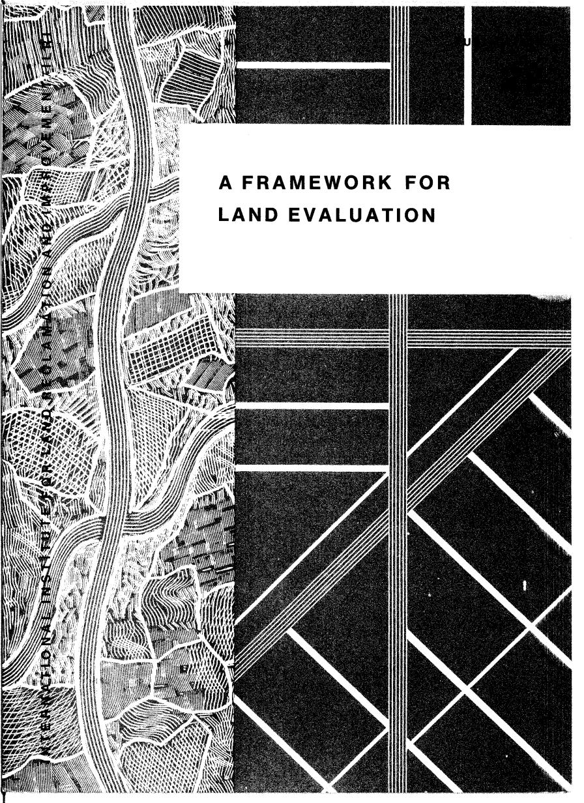
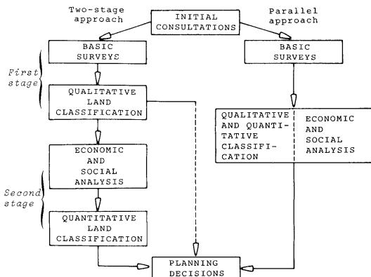
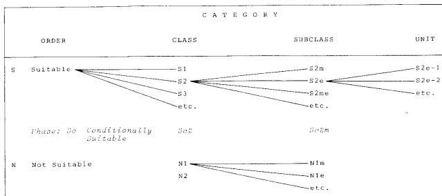
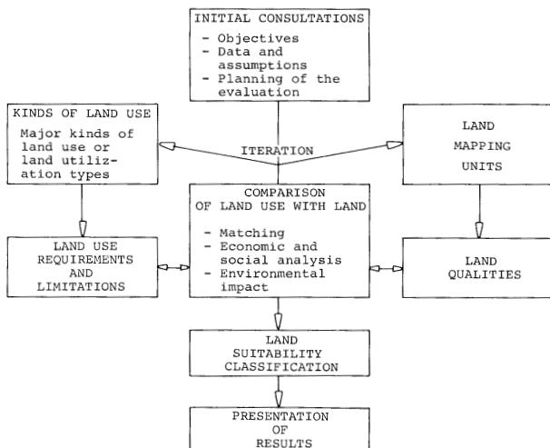
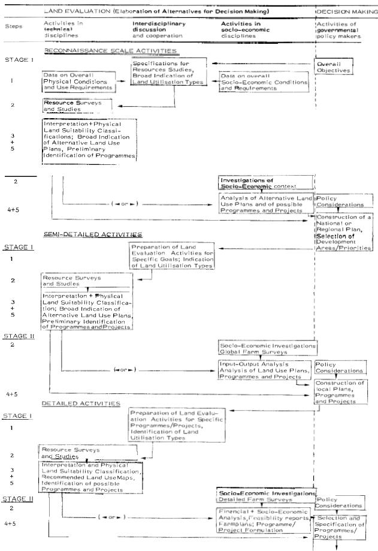
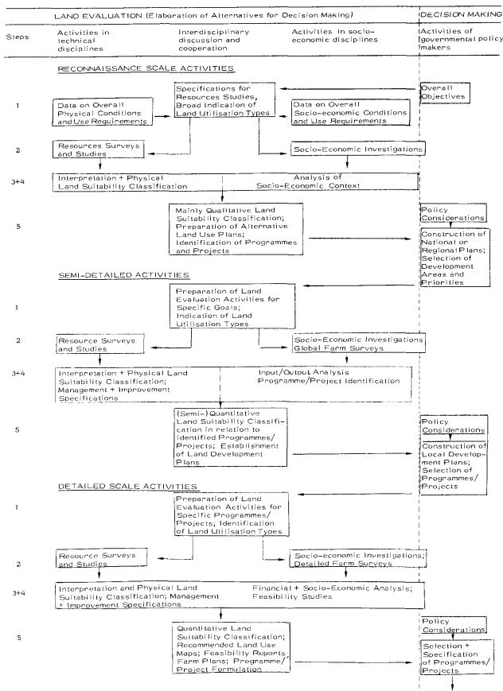
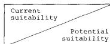

The background is a high-contrast, black and white abstract design. On the left side, there is a vertical strip containing a complex pattern of fine, wavy lines and a small, detailed illustration of a city grid. This strip is bordered by a thick, dark vertical band. The right side of the image is dominated by a large, dark rectangular area with a prominent, light-colored geometric grid pattern consisting of intersecting lines forming squares and diamonds.

Abstract background with a vertical strip of topographical and urban patterns on the left and a geometric grid pattern on the right.

# **A FRAMEWORK FOR LAND EVALUATION**

INTERNATIONAL INSTITUTE FOR LAND RECLAMATION AND IMPROVEMENT (ILRI)

# A FRAMEWORK FOR LAND EVALUATION

Soil Resources Development and Conservation Service  
Land and Water Development Division  
Food and Agriculture Organization  
of the United Nations

Published by arrangement with the  
FOOD AND AGRICULTURE ORGANIZATION  
OF THE UNITED NATIONS


The logo consists of a square frame divided into four quadrants. The top-left quadrant is solid black. The top-right quadrant contains a stylized 'i'. The bottom-left quadrant contains a stylized 'l'. The bottom-right quadrant is solid black.

Logo of the International Institute for Land Reclamation and Improvement (ILRI), featuring a stylized 'i' and 'l' within a square frame.

INTERNATIONAL INSTITUTE FOR LAND RECLAMATION AND IMPROVEMENT/ILRI  
P.O. BOX 45 WAGENINGEN THE NETHERLANDS 1977

The designations employed and the presentation of material in this publication do not imply the expression of any opinion whatsoever on the part of the Food and Agriculture Organization of the United Nations concerning the legal status of any country, territory, city or area or of its authorities, or concerning the delimitation of its frontiers or boundaries.

This book is published as:  
FAO Soils Bulletin No. 32  
ILRI Publication No. 22

The copyright in this book is vested in the Food and Agriculture Organization of the United Nations. The book may not be reproduced, in whole or in part, by any method or process, without written permission from the copyright holder. Applications for such permission, with a statement of the purpose and extent of the reproduction desired, should be addressed to the Director, Publications Division, Food and Agriculture Organization of the United Nations, Via delle Terme di Caracalla, 00100 Rome, Italy.

© FAO 1976

# Preface

By 1970 many countries had developed their own systems of land evaluation. This made exchange of information difficult, and there was a clear need for international discussion to achieve some form of standardization.<sup>1</sup> Preparatory work undertaken by two committees, one in The Netherlands and one in FAO, led to the production of a background document (FAO, 1972). This document, together with papers describing land classification systems throughout the world (FAO, 1974), was discussed at a meeting of international experts held in Wageningen in October 1972. Agreement was reached on most of the principles of the proposed framework for land evaluation, and a summary of the discussions and recommendations of the meeting was published (Brinkman and Smyth, 1973).

The next stage was the writing of the first draft of a Framework (FAO, 1973). This was widely circulated with a request for comments. In the light of these comments a smaller meeting was held in Rome in January 1975, in which gaps in the draft Framework were identified and suggestions made for improvement. The discussions and recommendations of this second meeting (FAO, 1975) form the basis from which the present document has been prepared.

A large number of experts in land evaluation, both within FAO and from many different countries, have contributed to or commented upon the present text. Major contributions to the development of the concepts and methods incorporated in the Framework have been made by K.J.Beek, J.Bennema, P.J.Mahler and A.J.Smyth. In particular the concepts of land utilization types, land qualities and matching owe much to the work of K.J.Beek and J.Bennema (1971). Others who have contributed to the development of methods, or supplied material, include C.A.Robertson and A.P.A.Vink. Extensive and valuable comments on the draft text have been received from participants in the 1975 meeting, also from M.Ashraf and J.H.de Vos t.N.C. The present text has been edited by R.Brinkman and A.Young.

Land evaluation is designed to serve practical purposes. The Framework, in its draft versions, has already been employed in a number of FAO land development projects. It is essential that it should now be extensively tested, by application to a wide variety of environments, physical, economic and social, and to a broad range of planning purposes. It is only by such practical applications that the Framework can serve its intended purpose: to contribute to the wise use of land resources by man.

---

<sup>1</sup> Two new systems, one developed in Iran and one in Brazil, drew attention to possibilities in this regard.

# Contents

# CHAPTER 1

## THE NATURE AND PRINCIPLES OF LAND EVALUATION

|       |                                                         |     |
| ----- | ------------------------------------------------------- | --- |
| 1.1   | General                                                 | 1   |
| 1.2   | The aims of land evaluation                             | 1   |
| 1.3   | Land evaluation and land use planning                   | 2   |
| 1.4   | Principles                                              | 4   |
| 1.5   | Levels of intensity and approaches                      | 6   |
| 1.5.1 | Levels of intensity                                     | 6   |
| 1.5.2 | Two-stage and parallel approaches<br>to land evaluation | 6   |
| 1.6   | The nature of the Framework                             | 8   |

# CHAPTER 2

## BASIC CONCEPTS

|       |                                                                 |     |
| ----- | --------------------------------------------------------------- | --- |
| 2.1   | General                                                         | 11  |
| 2.2   | Land                                                            | 11  |
| 2.3   | Land use                                                        | 12  |
| 2.3.1 | Major kinds of land use and land utilization types              | 12  |
| 2.3.2 | Multiple and compound land use                                  | 14  |
| 2.4   | Land characteristics, land qualities and diagnostic<br>criteria | 14  |
| 2.4.1 | Examples                                                        | 17  |
| 2.4.2 | The scarcity value of land                                      | 18  |
| 2.5   | Requirements and limitations                                    | 18  |
| 2.6   | Land improvements                                               | 19  |
| 2.7   | Land suitability and land capability                            | 20  |

# CHAPTER 3

## LAND SUITABILITY CLASSIFICATIONS

|       |                                             |     |
| ----- | ------------------------------------------- | --- |
| 3.1   | General                                     | 21  |
| 3.2   | Structure of the suitability classification | 21  |
| 3.2.1 | Land Suitability Orders                     | 22  |
| 3.2.2 | Land Suitability Classes                    | 22  |
| 3.2.3 | Land Suitability Subclasses                 | 25  |
| 3.2.4 | Land Suitability Units                      | 25  |
| 3.2.5 | Conditional Suitability                     | 26  |
| 3.2.6 | Summary                                     | 27  |

|       |                                                      |     |
| ----- | ---------------------------------------------------- | --- |
| 3.3   | The range of classifications                         | 27  |
| 3.3.1 | Qualitative and quantitative classifications         | 28  |
| 3.3.2 | Classifications of current and potential suitability | 28  |
| 3.4   | The results of land suitability evaluation           | 29  |

# CHAPTER 4 LAND EVALUATION PROCEDURES

|       |                                                           |     |
| ----- | --------------------------------------------------------- | --- |
| 4.1   | General                                                   | 33  |
| 4.2   | Initial consultations                                     | 35  |
| 4.2.1 | Objectives                                                | 35  |
| 4.2.2 | The context of the study area                             | 37  |
| 4.2.3 | Data and assumptions underlying the evaluation            | 37  |
| 4.2.4 | Planning the evaluation                                   | 39  |
| 4.3   | Kinds of land use and their requirements and limitations  | 41  |
| 4.3.1 | Description of kinds of land use                          | 41  |
| 4.3.2 | Identification of requirements of the use and limitations | 42  |
| 4.4   | Description of land mapping units and land qualities      | 43  |
| 4.5   | Comparison of land use with land                          | 43  |
| 4.5.1 | Matching of land use with land                            | 44  |
| 4.5.2 | Diagnostic procedures                                     | 45  |
| 4.5.3 | Estimation of benefits and inputs                         | 47  |
| 4.5.4 | Assessment of environmental impact                        | 48  |
| 4.6   | Economic and social analysis                              | 49  |
| 4.7   | Land suitability classification                           | 51  |
| 4.7.1 | The field check                                           | 51  |
| 4.8   | Synopsis of procedures                                    | 54  |
| 4.9   | Presentation of results                                   | 54  |

# CHAPTER 5 EXAMPLES

|       |                                                         |     |
| ----- | ------------------------------------------------------- | --- |
| 5.1   | General                                                 | 57  |
| 5.2   | Land uses and land qualities in Brazil                  | 58  |
| 5.2.1 | Description of the land utilization types               | 58  |
| 5.2.2 | Example of a land quality: limitations to mechanization | 60  |
| 5.2.3 | Suitability description of a land mapping unit          | 63  |

|       |                                                             |     |
| ----- | ----------------------------------------------------------- | --- |
| 5.3   | Smallholders' oil palm cultivation in Surinam               | 64  |
| 5.3.1 | Description of land use (data and assumptions)              | 64  |
| 5.3.2 | Social and economic context                                 | 65  |
| 5.3.3 | Required land qualities                                     | 65  |
| 5.3.4 | Composition of the main land qualities                      | 66  |
| 5.3.5 | Land suitability classification                             | 70  |
| 5.4   | Land utilization types in Kenya                             | 71  |
| 5.4.1 | Smallholders rainfed arable farming: traditional technology | 74  |
| 5.5   | Location as a land quality                                  | 77  |
|       | Glossary                                                    | 81  |
|       | References                                                  | 85  |

## LIST OF TABLES

|     |                                                                                |     |
| --- | ------------------------------------------------------------------------------ | --- |
| 1.  | Examples of land qualities                                                     | 16  |
| 2.  | Structure of the suitability classification                                    | 27  |
| 3.  | Tabular legends to land suitability maps                                       | 55  |
| 4.  | Degrees of limitation for mechanization in Brazil                              | 63  |
| 5.  | Some important land qualities in Surinam                                       | 66  |
| 6.  | Criteria and ratings for moisture availability                                 | 67  |
| 7.  | Criteria and ratings for oxygen availability in the root zone                  | 68  |
| 8.  | Criteria and ratings for nutrient availability                                 | 69  |
| 9.  | Criteria and ratings for trafficability and for accessibility                  | 70  |
| 10. | Quantifiable factors for each land utilization type in Eastern Province, Kenya | 72  |
| 11. | Road classification and transport cost index in Japan                          | 79  |

## LIST OF FIGURES

|     |                                                           |     |
| --- | --------------------------------------------------------- | --- |
| 1.  | Two-stage and parallel approaches to land evaluation      | 7   |
| 2.  | Examples of qualitative land suitability maps             | 31  |
| 3.  | Schematic representation of activities in land evaluation | 34  |
| 4.  | Two-stage approach to land evaluation                     | 52  |
| 5.  | Parallel approach to land evaluation                      | 53  |

# Chapter 1The nature and principles of land evaluation

## 1.1 General

Decisions on land use have always been part of the evolution of human society. In the past, land use changes often came about by gradual evolution, as the result of many separate decisions taken by individuals. In the more crowded and complex world of the present they are frequently brought about by the process of land use planning. Such planning takes place in all parts of the world, including both developing and developed countries. It may be concerned with putting environmental resources to new kinds of productive use. The need for land use planning is frequently brought about, however, by changing needs and pressures, involving competing uses for the same land.

The function of land use planning is to guide decisions on land use in such a way that the resources of the environment are put to the most beneficial use for man, whilst at the same time conserving those resources for the future. This planning must be based on an understanding both of the natural environment and of the kinds of land use envisaged. There have been many examples of damage to natural resources and of unsuccessful land use enterprises through failure to take account of the mutual relationships between land and the uses to which it is put. It is a function of land evaluation to bring about such understanding and to present planners with comparisons of the most promising kinds of land use.

Land evaluation is concerned with the assessment of land performance when used for specified purposes. It involves the execution and interpretation of basic surveys of climate, soils, vegetation and other aspects of land in terms of the requirements of alternative forms of land use. To be of value in planning, the range of land uses considered has to be limited to those which are relevant within the physical, economic and social context of the area considered, and the comparisons must incorporate economic considerations.

## 1.2 The aims of land evaluation

Land evaluation may be concerned with present land performance. Frequently, however, it involves change and its effects: change in the use of land and in some cases change in the land itself.

Evaluation takes into consideration the economics of the proposed enterprises, the social consequences for the people of the area and the country concerned, and the consequences, beneficial or adverse, for the environment. Thus land evaluation should answer the following questions:

- How is the land currently managed, and what will happen if present practices remain unchanged?
- What improvements in management practices, within the present use, are possible?
- What other uses of land are physically possible and economically and socially relevant?
- Which of these uses offer possibilities of sustained production or other benefits?
- What adverse effects, physical, economic or social, are associated with each use?
- What recurrent inputs are necessary to bring about the desired production and minimize the adverse effects?
- What are the benefits of each form of use?

If the introduction of a new use involves significant change in the land itself, as for example in irrigation schemes, then the following additional questions should be answered:

- What changes in the condition of the land are feasible and necessary, and how can they be brought about?
- What non-recurrent inputs are necessary to implement these changes?

The evaluation process does not in itself determine the land use changes that are to be carried out, but provides data on the basis of which such decisions can be taken. To be effective in this role, the output from an evaluation normally gives information on two or more potential forms of use for each area of land, including the consequences, beneficial and adverse, of each.

## 1.3 Land evaluation and land use planning

Land evaluation is only part of the process of land use planning. Its precise role varies in different circumstances. In the present context it is sufficient to

represent the land use planning process by the following generalized sequence of activities and decisions:

- i. recognition of a need for change;
- ii. identification of aims;
- iii. formulation of proposals, involving alternative forms of land use, and recognition of their main requirements;
- iv. recognition and delineation of the different types of land present in the area;
- v. comparison and evaluation of each type of land for the different uses;
- vi. selection of a preferred use for each type of land;
- vii. project design, or other detailed analysis of a selected set of alternatives for distinct parts of the area - this, in certain cases, may take the form of a feasibility study;
- viii. decision to implement;
- ix. implementation;
- x. monitoring of the operation.

Land evaluation plays a major part in stages iii, iv and v of the above sequence, and contributes information to the subsequent activities. Thus land evaluation is preceded by the recognition of the need for some change in the use to which land is put; this may be the development of new productive uses, such as agricultural development schemes or forestry plantations, or the provision of services, such as the designation of a national park or recreational area.

Recognition of this need is followed by identification of the aims of the proposed change and formulation of general and specific proposals. The evaluation process itself includes description of a range of promising kinds of use, and the assessment and comparison of these with respect to each type of land identified in the area. This leads to recommendations involving one or a small number of preferred kinds of use. These recommendations can then be used in making decisions on the preferred kinds of land use for each distinct part of the area. Later stages will usually involve further detailed analysis of the preferred uses, followed, if the decision to go ahead is made, by the implementation of the development project or other form of change, and monitoring of the resulting systems.

## 1.4 Principles

Certain principles are fundamental to the approach and methods employed in land evaluation. These basic principles are as follows:

- i. _Land suitability is assessed and classified with respect to specified kinds of use_

This principle embodies recognition of the fact that different kinds of land use have different requirements. As an example, an alluvial floodplain with impeded drainage might be highly suitable for rice cultivation but not suitable for many forms of agriculture or for forestry.

The concept of land suitability is only meaningful in terms of specific kinds of land use, each with their own requirements, e.g. for soil moisture, rooting depth etc. The qualities of each type of land, such as moisture availability or liability to flooding, are compared with the requirements of each use. Thus the land itself and the land use are equally fundamental to land suitability evaluation.

- ii. _Evaluation requires a comparison of the benefits obtained and the inputs needed on different types of land_

Land in itself, without inputs, rarely if ever possesses productive potential; even the collection of wild fruits requires labour, whilst the use of natural wilderness for nature conservation requires measures for its protection. Suitability for each use is assessed by comparing the required inputs, such as labour, fertilizers or road construction, with the goods produced or other benefits obtained.

- iii. _A multidisciplinary approach is required_

The evaluation process requires contributions from the fields of natural science, the technology of land use, economics and sociology. In particular, suitability evaluation always incorporates economic considerations to a greater or lesser extent. In qualitative evaluation, economics may be employed in general terms only, without calculation of costs and returns. In quantitative evaluation the comparison of benefits and inputs in economic terms plays a major part in the determination of suitability.

It follows that a team carrying out an evaluation requires a range of specialists. These will usually include natural scientists (e.g. geomorphologists, soil surveyors, ecologists), specialists in the technology of the forms of land use under consideration (e.g. agronomists, foresters, irrigation engineers, experts in livestock management), economists and sociologists. There may need to be some combining of these functions for practical reasons, but the principle of multidisciplinary activity, encompassing studies of land, land use, social aspects and economics, remains.

- iv. _Evaluation is made in terms relevant to the physical, economic and social context of the area concerned_

Such factors as the regional climate, levels of living of the population, availability and cost of labour, need for employment, the local or export markets, systems of land tenure which are socially and politically acceptable, and availability of capital, form the context within which evaluation takes place. It would, for example, be unrealistic to say that land was suitable for non-mechanized rice cultivation, requiring large amounts of low-cost labour, in a country with high labour costs. The assumptions underlying evaluation will differ from one country to another and, to some extent, between different areas of the same country. Many of these factors are often implicitly assumed; to avoid misunderstanding and to assist in comparisons between different areas, such assumptions should be explicitly stated.

- v. _Suitability refers to use on a sustained basis_

The aspect of environmental degradation is taken into account when assessing suitability. There might, for example, be forms of land use which appeared to be highly profitable in the short run but were likely to lead to soil erosion, progressive pasture degradation, or adverse changes in river regimes downstream. Such consequences would outweigh the short-term profitability and cause the land to be classed as not suitable for such purposes.

This principle by no means requires that the environment should be preserved in a completely unaltered state. Agriculture normally involves clearance of any natural vegetation present, and normally soil fertility under arable cropping is higher or lower, depending on management, but rarely at the same level as under the original vegetation. What is required is that for any proposed form of land use, the probable consequences for the environment should be assessed as accurately as possible and such assessments taken into consideration in determining suitability.

- vi. _Evaluation involves comparison of more than a single kind of use_

This comparison could be, for example, between agriculture and forestry, between two or more different farming systems, or between individual crops. Often it will include comparing the existing uses with possible changes, either to new kinds of use or modifications to the existing uses. Occasionally a proposed form of use will be compared with non-use, i.e. leaving the land in its unaltered state, but the principle of comparison remains. Evaluation is only reliable if benefits and inputs from any given kind of use can be compared with at least one, and usually several different, alternatives. If only one use is considered there is the danger that, whilst the land may indeed be suitable for that use, some other and more beneficial use may be ignored.

## 1.5 Levels of intensity and approaches

Certain groups of activities are common to all types of land evaluation. In all cases evaluation commences with initial consultations, concerned with the objectives of the evaluation, assumptions and constraints, and the methods to be followed. Details of subsequent activities and the sequence in which they are carried out, vary with circumstances. These circumstances include the level of intensity of the survey and which of two overall approaches is followed.

### 1.5.1 Levels of intensity

Three levels of intensity may be distinguished: reconnaissance, semi-detailed and detailed. These are normally reflected in the scales of resulting maps.

Reconnaissance surveys are concerned with broad inventory of resources and development possibilities at regional and national scales. Economic analysis is only in very general terms, and land evaluation is qualitative. The results contribute to national plans, permitting the selection of development areas and priorities.

Surveys at the semi-detailed, or intermediate, level are concerned with more specific aims such as feasibility studies of development projects. The work may include farm surveys; economic analysis is considerably more important, and land evaluation is usually quantitative. This level provides information for decisions on the selection of projects, or whether a particular development or other change is to go ahead.

The detailed level covers surveys for actual planning and design, or farm planning and advice, often carried out after the decision to implement has been made.

### 1.5.2 Two-stage and parallel approaches to land evaluation

The relationships of resource surveys and economic and social analysis, and the manner in which the kinds of land use are formulated, depend on which of the following approaches to land evaluation is adopted (Fig.1):

- a two-stage approach in which the first stage is mainly concerned with qualitative land evaluation, later (although not necessarily) followed by a second stage consisting of economic and social analysis;
- a parallel approach in which analysis of the relationships between land and land use proceeds concurrently with economic and social analysis.



```

graph TD
    IC[INITIAL CONSULTATIONS] --> T2A[Two-stage approach]
    IC --> PA[Parallel approach]

    T2A --> BS1[BASIC SURVEYS]
    BS1 --> QLC1[QUALITATIVE LAND CLASSIFICATION]
    QLC1 --> ESA[ECONOMIC AND SOCIAL ANALYSIS]
    ESA --> QLC2[QUANTITATIVE LAND CLASSIFICATION]
    QLC2 --> PD[PLANNING DECISIONS]

    PA --> BS2[BASIC SURVEYS]
    BS2 --> QQA[ECONOMIC AND SOCIAL ANALYSIS]
    QQA --> PD

    QLC1 -.-> PD

    subgraph FirstStage [First stage]
        BS1
        QLC1
    end

    subgraph SecondStage [Second stage]
        ESA
        QLC2
    end

```

The diagram illustrates two approaches to land evaluation starting from 'INITIAL CONSULTATIONS'. The 'Two-stage approach' involves a sequence of steps: 'BASIC SURVEYS' (labeled as the 'First stage'), 'QUALITATIVE LAND CLASSIFICATION', 'ECONOMIC AND SOCIAL ANALYSIS' (labeled as the 'Second stage'), and 'QUANTITATIVE LAND CLASSIFICATION', all leading to 'PLANNING DECISIONS'. The 'Parallel approach' involves 'BASIC SURVEYS' leading to a box containing 'QUALITATIVE AND QUANTITATIVE CLASSIFICATION' and 'ECONOMIC AND SOCIAL ANALYSIS', which then leads to 'PLANNING DECISIONS'. A dashed line also connects 'QUALITATIVE LAND CLASSIFICATION' from the two-stage approach to 'PLANNING DECISIONS'.

Flowchart comparing two-stage and parallel approaches to land evaluation.

Fig.1. Two-stage and parallel approaches to land evaluation.

The two-stage approach is often used in resource inventories for broad planning purposes and in studies for the assessment of biological productive potential. The land suitability classifications in the first stage are based on the suitability of the land for kinds of land use which are selected at the beginning of the survey, e.g. arable cropping, dairy farming, maize, tomatoes. The contribution of economic and social analysis to the first stage is limited to a check on the relevance of the kinds of land use. After the first stage has been completed and

its results presented in map and report form, these results may then be subject to the second stage, that of economic and social analysis, either immediately or after an interval of time.

In the parallel approach the economic and social analysis of the kinds of land use proceeds simultaneously with the survey and assessment of physical factors. The kinds of use to which the evaluation refers are usually modified in the course of the study. In the case of arable farming, for example, this modification may include selection of crops and rotations, estimates of the inputs of capital and labour, and determination of optimum farm size. Similarly, in forestry it may include, for example, selection of tree species, dates of thinning and felling and required protective measures. This procedure is mostly favoured for specific proposals in connection with development projects and at semi-detailed and detailed levels of intensity.

The parallel approach is expected to give more precise results in a shorter period of time. It offers a better chance of concentrating survey and data-collection activities on producing information needed for the evaluation.

However, the two-stage approach appears more straightforward, possessing a clear-cut sequence of activities. The physical resource surveys precede economic and social analysis, without overlap, hence permitting a more flexible timing of activities and of staff recruitment. The two-stage approach is used as a background in the subsequent text except where otherwise stated.

## 1.6 The nature of the framework

The Framework does not by itself constitute an evaluation system. The range of possible uses of land and purposes of evaluation is so wide that no one system could hope to take account of them. Besides such obvious contrasts as those of climate, differences in such matters as the availability and cost of labour, availability of capital, population density and levels of living will all cause differences of detail and emphasis in the evaluation of land.

It was recognition of this situation, coupled with the need for some degree of standardization or compatibility, which led to the concept of the Framework for Land Evaluation. The Framework is a set of principles and concepts, on the basis of which local, national or regional evaluation systems can be constructed. Thus the Framework is not an evaluation manual; it does not, for example, specify such matters as limiting slope angles or soil moisture requirements for parti-

cular kinds of land use, since such values can never have universal applicability. Instead, the Framework sets out a number of principles involved in land evaluation, some basic concepts, the structure of a suitability classification and the procedures necessary to carry out a land suitability evaluation.

The principles and procedures given in the Framework can be applied in all parts of the world. They are relevant both to less developed and developed countries. At the one extreme, they can be applied to areas where development planning is being applied to the more or less unaltered natural environment; at the other, to densely populated lands where the main concern of planning is to reconcile competing demands for land already under various forms of use. The Framework can be used to construct systems applicable at all levels of intensity ranging from, at one extreme, national, continental or world-scale assessments, and at the other to detailed local studies. The Framework covers all kinds of rural land use: agriculture in its broadest sense, including livestock production, together with forestry, recreation or tourism, and nature conservation. Engineering aspects involved in rural land use, such as foundation suitability for roads or small structures, are also included.

The Framework is not intended for the distinct set of planning procedures involved in urban land use planning, although some of its principles are applicable in these contexts. Nor does the Framework take account of the resources of the seas. Water on and beneath the surface of the land is, however, of relevance in land evaluation.

This Framework is written mainly for those actively involved in rural land evaluation. Since most land suitability evaluations are at present carried out for purposes of planning by national and local governments, this is the situation assumed in references to decision-making, but the evaluation can also be applied to land use planning by firms, farmers or other individuals. The principles and procedures which are set out can be applied either to land evaluation for individual land development projects or to the construction of local or national evaluation systems.

# Chapter 2Basic concepts

## 2.1 General

Certain concepts and definitions are needed as a basis for the subsequent discussion. These concern the land itself, kinds of land use, land characteristics and qualities, and improvements made to land.

For the sake of clarity, some definitions are given in the text in simplified form. Formal definitions of terms used in a specialized sense are given in the Glossary.

## 2.2 Land

Land comprises the physical environment, including climate, relief, soils, hydrology and vegetation, to the extent that these influence potential for land use. It includes the results of past and present human activity, e.g. reclamation from the sea, vegetation clearance, and also adverse results, e.g. soil salinization. Purely economic and social characteristics, however, are not included in the concept of land; these form part of the economic and social context.

A land mapping unit is a mapped area of land with specified characteristics. Land mapping units are defined and mapped by natural resource surveys, e.g. soil survey, forest inventory. Their degree of homogeneity or of internal variation varies with the scale and intensity of the study. In some cases a single land mapping unit may include two or more distinct types of land, with different suitabilities, e.g. a river flood plain, mapped as a single unit but known to contain both well-drained alluvial areas and swampy depressions.

Land is thus a wider concept than soil or terrain. Variation in soils, or soils and landforms, is often the main cause of differences between land mapping units within a local area: it is for this reason that soil surveys are sometimes the main basis for definition of land mapping units. However, the fitness of soils for land use cannot be assessed in isolation from other aspects of the environment, and hence it is land which is employed as the basis for suitability evaluation.

## 2.3 Land use

Suitability evaluation involves relating land mapping units to specified types of land use. The types of use considered are limited to those which appear to be relevant under the general physical, economic and social conditions prevailing in an area. These kinds of land use serve as the subject of land evaluation. They may consist of major kinds of land use or land utilization types.

### 2.3.1 Major kinds of land use and land utilization types

A major kind of land use is a major subdivision of rural land use, such as rainfed agriculture, irrigated agriculture, grassland, forestry, or recreation. Major kinds of land use are usually considered in land evaluation studies of a qualitative or reconnaissance nature.

A land utilization type is a kind of land use described or defined in a degree of detail greater than that of a major kind of land use. In detailed or quantitative land evaluation studies, the kinds of land use considered will usually consist of land utilization types. They are described with as much detail and precision as the purpose requires. Thus land utilization types are not a categorical level in a classification of land use, but refer to any defined use below the level of the major kind of land use.

A land utilization type consists of a set of technical specifications in a given physical, economic and social setting. This may be the current environment, or a future setting modified by major land improvements, e.g. an irrigation and drainage scheme. Attributes of land utilization types include data or assumptions on:

- Produce, including goods (e.g. crops, livestock, timber), services (e.g. recreational facilities) or other benefits (e.g. wildlife conservation)
- Market orientation, including whether towards subsistence or commercial production
- Capital intensity
- Labour intensity
- Power sources (e.g. man's labour, draught animals, machinery using fuels)
- Technical knowledge and attitudes of land users

- Technology employed (e.g. implements and machinery, fertilizers, livestock breeds, farm transport, methods of timber felling)
- Infrastructure requirements (e.g. sawmills, tea factories, agricultural advisory services)
- Size and configuration of land holdings, including whether consolidated or fragmented
- Land tenure, the legal or customary manner in which rights to land are held, by individuals or groups
- Income levels, expressed per capita, per unit of production (e.g. farm) or per unit area.

Management practices on different areas within one land utilization type are not necessarily the same. For example, the land utilization type may consist of mixed farming, with part of the land under arable use and part allocated to grazing. Such differences may arise from variation in the land, from the requirements of the management system, or both.

Some examples of land utilization types are:

- i. Rainfed annual cropping based on groundnuts with subsistence maize, by smallholders with low capital resources, using cattle-drawn farm implements, with high labour intensity, on freehold farms of 5-10 ha.
- ii. Farming similar to (i) in respect of production, capital, labour, power and technology, but farms of 200-500 ha operated on a communal basis.
- iii. Commercial wheat production on large freehold farms, with high capital and low labour intensity, and a high level of mechanization and inputs.
- iv. Extensive cattle ranching, with medium levels of capital and labour intensity, with land held and central services operated by a governmental agency.
- v. Softwood plantations operated by a government Department of Forestry, with high capital intensity, low labour intensity, and advanced technology.
- vi. A national park for recreation and tourism.

Some descriptions of land utilization types are given in Chapter 5.

Where it is wished to relate agricultural land utilization types to a general classification, the Typology of World Agriculture of the International Geographical Union may be considered (Kostrowicki, 1974). The role of land utilization types in land evaluation is discussed further in Beek (1975).

### 2.3.2 Multiple and compound land use

Two terms, multiple and compound land utilization types, refer to situations in which more than one kind of land use is practised within an area.

A multiple land utilization type consists of more than one kind of use simultaneously undertaken on the same area of land, each use having its own inputs, requirements and produce. An example is a timber plantation used simultaneously as a recreational area.

A compound land utilization type consists of more than one kind of use undertaken on areas of land which for purposes of evaluation are treated as a single unit. The different kinds of use may occur in time sequence (e.g. as in crop rotation) or simultaneously on different areas of land within the same organizational unit. Mixed farming involving both arable use and grazing is an example.

Sometimes an appropriate land utilization type can be found by making several land mapping units part of the same management unit, e.g. livestock management which combines grazing on uplands in the rainy season and on seasonally flooded lowlands in the dry season.

Land utilization types are defined for the purpose of land evaluation. Their description need not comprise the full range of farm management practices, but only those related to land management and improvement. At detailed levels of evaluation, closely-defined land utilization types can be extended into farming systems by adding other aspects of farm management. Conversely, farming systems that have already been studied and described can be adopted as the basis for land utilization types.

## 2.4 Land characteristics, land qualities and diagnostic criteria

A land characteristic is an attribute of land that can be measured or estimated. Examples are slope angle, rainfall, soil texture, available water capacity, biomass of the vegetation, etc. Land mapping units, as determined by resource surveys, are normally described in terms of land characteristics.

If land characteristics are employed directly in evaluation, problems arise from the interaction between characteristics. For example, the hazard of soil erosion is determined not by slope angle alone but by the interaction between

slope angle, slope length, permeability, soil structure, rainfall intensity and other characteristics. Because of this problem of interaction, it is recommended that the comparison of land with land use should be carried out in terms of land qualities.

A land quality is a complex attribute of land which acts in a distinct manner in its influence on the suitability of land for a specific kind of use. Land qualities may be expressed in a positive or negative way. Examples are moisture availability, erosion resistance, flooding hazard, nutritive value of pastures, accessibility. Where data are available, aggregate land qualities may also be employed, e.g. crop yields, mean annual increments of timber species.

Table 1 gives an illustrative list of land qualities related to productivity from three kinds of use and to management and inputs. It is not exhaustive, nor is each land quality necessarily relevant for a particular area and type of land use. The qualities listed in B and C are in addition to those of A, which may be relevant to all three kinds of use (based in part on Beek and Bennema, 1972). There may also be land qualities related to major land improvements. These vary widely with the types of improvement under consideration. An example is land evaluation in relation to available supplies of water where irrigation is being considered.

A land quality is not necessarily restricted in its influence to one kind of use. The same quality may affect, for example, both arable use and animal production.

There are a very large number of land qualities, but only those relevant to the land use alternatives under consideration need be determined. A land quality is relevant to a given type of land use if it influences either the level of inputs required, or the magnitude of benefits obtained, or both. For example, capacity to retain fertilizers is a land quality relevant to most forms of agriculture, and one which influences both fertilizer inputs and crop yield. Erosion resistance affects the costs of soil conservation works required for arable use, whilst the nutritive value of pastures affects the productivity of land under ranching.

Land qualities can sometimes be estimated or measured directly, but are frequently described by means of land characteristics. Qualities or characteristics employed to determine limits of land suitability classes or subclasses are known as diagnostic criteria.

A diagnostic criterion is a variable which has an understood influence upon the output from, or the required inputs to, a specified use, and which serves as a basis for assessing the suitability of a given area of land for that use. This variable may be a land quality, a land characteristic, or a function of several land characteristics. For every diagnostic criterion there will be a critical value or set of critical values which are used to define suitability class limits.

TABLE 1. EXAMPLES OF LAND QUALITIES

- A. LAND QUALITIES RELATED TO PRODUCTIVITY FROM CROPS OR OTHER PLANT GROWTH
- Crop yields (a resultant of many qualities listed below)
  - Moisture availability
  - Nutrient availability
  - Oxygen availability in the root zone
  - Adequacy of foothold for roots
  - Conditions for germination
  - Workability of the land (ease of cultivation)
  - Salinity or alkalinity
  - Soil toxicity
  - Resistance to soil erosion
  - Pests and diseases related to the land
  - Flooding hazard (including frequency, periods of inundation)
  - Temperature regime
  - Radiation energy and photoperiod
  - Climatic hazards affecting plant growth (including wind, hail, frost)
  - Air humidity as affecting plant growth
  - Drying periods for ripening of crops
- B. LAND QUALITIES RELATED TO DOMESTIC ANIMAL PRODUCTIVITY
- Productivity of grazing land (a resultant of many qualities listed under A)
  - Climatic hardships affecting animals
  - Endemic pests and diseases
  - Nutritive value of grazing land
  - Toxicity of grazing land
  - Resistance to degradation of vegetation
  - Resistance to soil erosion under grazing conditions
  - Availability of drinking water
- C. LAND QUALITIES RELATED TO FOREST PRODUCTIVITY
- The qualities listed may refer to natural forests, forestry plantations, or both.
- Mean annual increments of timber species (a resultant of many qualities listed under A)
  - Types and quantities of indigenous timber species
  - Site factors affecting establishment of young trees
  - Pests and diseases
  - Fire hazard
- D. LAND QUALITIES RELATED TO MANAGEMENT AND INPUTS
- The qualities listed may refer to arable use, animal production or forestry.
- Terrain factors affecting mechanization (trafficability)
  - Terrain factors affecting construction and maintenance of access roads (accessability)
  - Size of potential management units (e.g. forest blocks, farms, fields)
  - Location in relation to markets and to supplies of inputs

### 2.4.1 Examples

These terms may be illustrated with reference to the land quality "oxygen availability in the root zone". This quality can be most closely estimated by the diagnostic criterion of the period when the redox potential (Eh) in the root zone is less than +200 millivolts. Such information would frequently not be available, in which case the next most direct criterion would be periods when the root zone lay below the water table. For example, oxygen availability might be classed as "moderate" with 3-6 months below the water table, and "low" with over 6 months. Failing information on periods with a high water table, then soil mottling, soil drainage class or natural vegetation could be used as diagnostic criteria for assessing oxygen availability.

Land qualities can sometimes be described by means of a single land characteristic, as in the preceding example. In many cases, however, their rating involves combinations of several characteristics, as in the case of moisture availability illustrated by the following example.

Moisture availability to plants is a land quality that is relevant in a wide variety of circumstances. It can apply to arable cropping, animal productivity (via its influence on growth of pastures) and forest production. It can affect both productivity, e.g. crop yields, and inputs, e.g. mulching measures necessary, or amounts of irrigation water required. Among the land characteristics which affect the quality moisture availability are: amount of rainfall, its seasonal distribution and variability; potential evapotranspiration, and hence the characteristics which themselves affect it (temperature, humidity, wind speed, etc.); and available water capacity of the soil, and the characteristics which affect it - effective soil depth (depth to which roots penetrate) and the field capacity and wilting point of each soil horizon, the latter being in turn influenced by texture, organic matter content, etc. The probable recurrence interval at which the soil moisture level falls to wilting point within the entire rooting zone is a further land characteristic of importance (which can be estimated but not measured within a short period). By no means all these land characteristics would be employed as diagnostic criteria. Supposing, for example, that differences in both rainfall and potential evapotranspiration within the surveyed area were so small as to be of little importance in differentiating types of land, then this characteristic would become part of the physical context of the evaluation and would not be used in defining class limits. The most appropriate diagnostic criterion used to define class limits might be available

water capacity of the soil profile. However, where such data were not available, some function of effective depth and soil texture, believed to bear a linear relationship with available water capacity, could be used. In the former case, the set of critical values for available water capacity used to define class limits might be such as: over 20 cm, 15-20 cm, 12-15 cm.

### 2.4.2 The scarcity value of land

The value of a particular type of land may be increased by its scarcity, or the rarity of certain of its qualities, within a given region or country. This is often the position with nature reserves. In the extreme case, the presence of a plant or animal species unique to one area may make that land virtually irreplaceable, resulting in strict protection even against highly profitable other uses. Situations where land acquires added suitability for a particular use by virtue of its scarcity can also arise with productive forms of use, for example where dry-season grazing land is in short supply.

## 2.5 Requirements and limitations

Requirements of the land use refer to the set of land qualities that determine the production and management conditions of a kind of land use.

Limitations are land qualities, or their expression by means of diagnostic criteria, which adversely affect a kind of land use.

For example, the requirements for mechanized cultivation of wheat include high availability of oxygen in the root zone and absence of obstructions (boulders or rock outcrops); waterlogging and the presence of boulders are limitations. Thus limitations may be regarded as land qualities expressed in such a way as to show the extent to which the conditions of the land fall short of the requirements for a given use.

## 2.6 Land improvements

Land improvements are activities which cause beneficial changes in the qualities of the land itself. Land improvements should be distinguished from improvements in land use, i.e. changes in the use to which the land is put or modifications to management practices under a given use.

Land improvements are classed as major or minor.

A major land improvement is a substantial and reasonably permanent improvement in the qualities of the land affecting a given use. A large non-recurrent input is required, usually taking the form of capital expenditure on structure and equipment. Once accomplished, maintenance of the improvement remains as a continuing cost, but the land itself is more suitable for the use than formerly. Examples are large irrigation schemes, drainage of swamps and reclamation of salinized land.

A minor land improvement is one which either has relatively small effects or is non-permanent or both, or which lies within the capacity of individual farmers or other land users. Stone clearance, eradication of persistent weeds and field drainage by ditches are examples.

The separation of major from minor land improvements is intended only as an aid to making a suitability classification. The distinction is a relative one; it is not clear-cut and is only valid within a local context. In cases of doubt, the main criterion is whether the improvement is within the technical and financial capacity of individual farmers or other landowners (including small communal owners, e.g. village co-operatives). In many areas improvements such as subsoiling, dynamiting or terracing cannot be undertaken by individual farmers, and are therefore regarded as major land improvements; in countries with large farms and high capital resources coupled with good credit facilities, however, these changes may be within reach of individuals and are therefore considered as minor improvements. Field drainage is another improvement that may or may not be regarded as major, depending on farm size, permanency of tenure, capital availability and level of technology.

## 2.7 Land suitability and land capability

The term "land capability" is used in a number of land classification systems, notably that of the Soil Conservation Service of the U.S. Department of Agriculture (Klingebiel and Montgomery, 1961). In the USDA system, soil mapping units are grouped primarily on the basis of their capability to produce common cultivated crops and pasture plants without deterioration over a long period of time. Capability is viewed by some as the inherent capacity of land to perform at a given level for a general use, and suitability as a statement of the adaptability of a given area for a specific kind of land use; others see capability as a classification of land primarily in relation to degradation hazards, whilst some regard the terms "suitability" and "capability" as interchangeable.

Because of these varying interpretations, coupled with the long-standing association of "capability" with the USDA system, the term land suitability is used in this Framework, and no further reference to capability is made.

# Chapter 3Land suitability classifications

## 3.1 General

Land suitability is the fitness of a given type of land for a defined use. The land may be considered in its present condition or after improvements. The process of land suitability classification is the appraisal and grouping of specific areas of land in terms of their suitability for defined uses.

In this chapter, the structure of the suitability classification is first described. This is followed by an account of the range of interpretative classifications recognized: qualitative or quantitative and of current or potential suitability. In accordance with the principles given in Chapter 1, separate classifications are made with respect to each kind of land use that appears to be relevant for the area. Thus, for example, in a region where arable use, animal production and forestry are all believed to be possible on certain areas, a separate suitability classification is made for each of these three kinds of use.

There may be certain parts of the area considered, for which particular kinds of use are not relevant, e.g. irrigated agriculture beyond a limit of water availability. In these circumstances, suitability need not be assessed. Such parts are shown on maps or tables by the symbol NR: Not Relevant.

## 3.2 Structure of the suitability classification

The Framework has the same structure, i.e. recognizes the same categories, in all of the kinds of interpretative classification (see below). Each category retains its basic meaning within the context of the different classifications and as applied to different kinds of land use. Four categories of decreasing generalization are recognized:

- |      |                              |                                                                                                |
  | ---- | ---------------------------- | ---------------------------------------------------------------------------------------------- |
  | i.   | Land Suitability Orders:     | reflecting kinds of suitability                                                                |
  | ii.  | Land Suitability Classes:    | reflecting degrees of suitability within Orders                                                |
  | iii. | Land Suitability Subclasses: | reflecting kinds of limitation, or main kinds of improvement measures required, within Classes |

#### iv. Land Suitability Units:

reflecting minor differences  
in required management within  
Subclasses.

### 3.2.1 Land Suitability Orders

Land suitability Orders indicate whether land is assessed as suitable or not suitable for the use under consideration. There are two Orders, represented in maps, tables, etc. by the symbols S and N respectively.

#### _Order S Suitable_

Land on which sustained use of the kind under consideration is expected to yield benefits which justify the inputs, without unacceptable risk of damage to land resources.

#### _Order N Not Suitable_

Land which has qualities that appear to preclude sustained use of the kind under consideration.

Land may be classed as Not Suitable for a given use for a number of reasons. It may be that the proposed use is technically impracticable, such as the irrigation of rocky steep land, or that it would cause severe environmental degradation, such as the cultivation of steep slopes. Frequently, however, the reason is economic: that the value of the expected benefits does not justify the expected costs of the inputs that would be required.

### 3.2.2 Land Suitability Classes

Land Suitability Classes reflect degrees of suitability. The classes are numbered consecutively, by arabic numbers, in sequence of decreasing degrees of suitability within the Order. Within the Order Suitable the number of classes is not specified. There might, for example, be only two, S1 and S2. The number of classes recognized should be kept to the minimum necessary to meet interpretative aims; five should probably be the most ever used.

If three Classes are recognized within the Order Suitable, as can often be recommended, the following names and definitions may be appropriate in a qualitative classification:

#### _Class S1 Highly Suitable_

Land having no significant limitations to sustained application of a given use, or only minor limitations that will not significantly reduce productivity or benefits and will not raise inputs above an acceptable level.

#### _Class S2 Moderately Suitable_

Land having limitations which in aggregate are moderately severe for sustained application of a given use; the limitations will reduce productivity or benefits and increase required inputs to the extent that the overall advantage to be gained from the use, although still attractive, will be appreciably inferior to that expected on Class S1 land.

#### _Class S3 Marginally Suitable_

Land having limitations which in aggregate are severe for sustained application of a given use and will so reduce productivity or benefits, or increase required inputs, that this expenditure will be only marginally justified.

In a quantitative classification, both inputs and benefits must be expressed in common measurable terms, normally economic. In different circumstances different variables may express most clearly the degree of suitability, e.g. the range of expected net income per unit area or per standard management unit, or the net return per unit of irrigation water applied to different types of land for a given use.

Where additional refinement is necessary it is recommended that this should be achieved by adding classes, e.g. S4, and not by subdividing classes, since the latter procedure would contradict the principle that degrees of suitability are represented by only one level of the classification structure, that of the suitability class. This necessarily changes the meanings of class numbers, e.g. if four classes were employed for classifying land with respect to arable use and only three with respect to forestry, Marginally Suitable could refer to S4 in the former case but S3 in the latter.

An alternative practice has been adopted in some countries. In order to give a constant numbering to the lowest Suitable class, classes have been subdivided as, e.g. S2.1, S2.2. This practice is permitted within the Framework, although for the reason given in the preceding paragraph it is not recommended.

Suitability Class S1, Highly Suitable, may sometimes not appear on a map of a limited area, but could still be included in the classification if such land is known or believed to occur in other areas relevant to the study.

Differences in degrees of suitability are determined mainly by the relationship between benefits and inputs. The benefits may consist of goods, e.g. crops, livestock products or timber, or services, e.g. recreational facilities. The inputs needed to obtain such benefits comprise such things as capital investment, labour, fertilizers and power. Thus an area of land might be classed as Highly Suitable for rainfed agriculture, because the value of crops produced substantially exceeds the costs of farming, but only Marginally Suitable for forestry, on grounds that the value of timber only slightly exceeds the costs of obtaining it.

It should be expected that boundaries between suitability classes will need review and revision with time in the light of technical developments and economic and social changes.

Within the Order Not Suitable, there are normally two Classes:

- |                                          |                                                                                                                                                                                                                                                      |
  | ---------------------------------------- | ---------------------------------------------------------------------------------------------------------------------------------------------------------------------------------------------------------------------------------------------------- |
  | <i>Class N1 Currently Not Suitable</i>   | Land having limitations which may be surmountable in time but which cannot be corrected with existing knowledge at currently acceptable cost; the limitations are so severe as to preclude successful sustained use of the land in the given manner. |
  | <i>Class N2 Permanently Not Suitable</i> | Land having limitations which appear so severe as to preclude any possibilities of successful sustained use of the land in the given manner.                                                                                                         |

Quantitative definition of these classes is normally unnecessary, since by definition both are uneconomic for the given use. The upper limit of Class N1 is already defined by the lower limit of the least suitable class in Order S.

The boundary of Class N2, Permanently Not Suitable, is normally physical and permanent. In contrast, the boundary between the two Orders, Suitable and Not Suitable, is likely to be variable over time through changes in the economic and social context.

### 3.2.3 Land Suitability Subclasses

Land Suitability Subclasses reflect kinds of limitations, e.g. moisture deficiency, erosion hazard. Subclasses are indicated by lower-case letters with mnemonic significance, e.g. S2m, S2e, S3me. Examples are given in Table 5. There are no subclasses in Class S1.

The number of subclasses recognized and the limitations chosen to distinguish them will differ in classifications for different purposes. There are two guidelines:

- The number of subclasses should be kept to a minimum that will satisfactorily distinguish lands within a class likely to differ significantly in their management requirements or potential for improvement due to differing limitations.
- As few limitations as possible should be used in the symbol for any subclass. One, rarely two, letters should normally suffice. The dominant symbol (i.e. that which determines the class) should be used alone if possible. If two limitations are equally severe, both may be given.

Land within the Order Not Suitable may be divided into suitability subclasses according to kinds of limitation, e.g. N1m, N1me, N1e although this is not essential. As this land will not be placed under management for the use concerned it should not be subdivided into suitability units.

### 3.2.4 Land Suitability Units

Land Suitability Units are subdivisions of a subclass. All the units within a subclass have the same degree of suitability at the class level and similar kinds of limitations at the subclass level. The units differ from each other in their production characteristics or in minor aspects of their management requirements (often definable as differences in detail of their limitations). Their recognition permits detailed interpretation at the farm planning level. Suitability units are distinguished by arabic numbers following a hyphen, e.g. S2e-1, S2e-2. There is no limit to the number of units recognized within a subclass.

### 3.2.5 Conditional Suitability

The designation Conditionally Suitable may be added in certain instances to condense and simplify presentation. This is necessary to cater for circumstances where small areas of land, within the survey area, may be unsuitable or poorly suitable for a particular use under the management specified for that use, but suitable given that certain conditions are fulfilled.

The possible nature of the conditions is varied and might relate to modifications to the management practices or the inputs of the defined land use (occasionally, for example, by localized phenomena of poor soil drainage, soil salinity); or to restrictions in the choice of crops (limited, for example, to crops with an especially high market value, or resistant to frost). In such instances, the indication "conditional" can avoid the need for additional classifications to account for local modifications of land use or local major improvements.

Conditionally Suitable is a phase of the Order Suitable. It is indicated by a lower case letter c between the order symbol and the class number, e.g. Sc2. The conditionally suitable phase, subdivided into classes if necessary, is always placed at the bottom of the listing of S classes. The phase indicates suitability after the condition(s) have been met.

Employment of the Conditionally Suitable phase should be avoided wherever possible. It may only be employed if all of the following stipulations are met:

- i. Without the condition(s) satisfied, the land is either not suitable or belongs to the lowest suitable class.
- ii. Suitability with the condition(s) satisfied is significantly higher (usually at least two classes).
- iii. The extent of the conditionally suitable land is very small with respect to the total study area.

If the first or second stipulation is not met, it may still be useful to mention the possible improvement or modification in an appropriate section of the text. If the third stipulation is not met, then the area over which the condition is relevant is sufficiently extensive to warrant either a new land utilization type or a potential suitability classification, as appropriate.

As the area of land classed as Conditionally Suitable is necessarily small, it will not normally be necessary to subdivide it at the unit level.

It is important to note that the indication "conditional" is not intended to be applied to land for which the interpretation is uncertain, either in the sense that its suitability is marginal or because factors relevant to suitability are not understood. Use of "conditional" may seem convenient to the evaluator, but its excessive use would greatly complicate understanding by users and must be avoided.

### 3.2.6 Summary

The structure of the suitability classification, together with the symbols used, is summarized in Table 2. Depending on the purpose, scale and intensity of the study, either the full range of suitability orders, classes, subclasses and units may be distinguished, or the classification may be restricted to the higher two or three categories.

TABLE 2. STRUCTURE OF THE SUITABILITY CLASSIFICATION



| C A T E G O R Y |                               |            |             |
| --------------- | ----------------------------- | ---------- | ----------- |
| ORDER           | CLASS                         | SUBCLASS   | UNIT        |
| S               | Suitable                      | S1         | S2e-1       |
|                 |                               | S2         | S2e-2       |
|                 |                               | S3         | etc.        |
|                 |                               | etc.       |             |
|                 | <i>Phase: So</i>              | <i>ScS</i> | <i>ScSm</i> |
|                 | <i>Conditionally Suitable</i> |            |             |
| N               | Not Suitable                  | N1         | N1a         |
|                 |                               | N2         | N1e         |
|                 |                               |            | etc.        |

## 3.3 The range of classifications

The Framework recognizes four main kinds of suitability classification, according to whether it is qualitative or quantitative, and refers to current or potential suitability.

Each classification is an appraisal and grouping of land units in terms of their suitability for a defined use.

### 3.3.1 Qualitative and quantitative classifications

A qualitative classification is one in which relative suitability is expressed in qualitative terms only, without precise calculation of costs and returns.

Qualitative classifications are based mainly on the physical productive potential of the land, with economics only present as a background. They are commonly employed in reconnaissance studies, aimed at a general appraisal of large areas.

A quantitative classification is one in which the distinctions between classes are defined in common numerical terms, which permits objective comparison between classes relating to different kinds of land use.

Quantitative classifications normally involve considerable use of economic criteria, i.e. costs and prices, applied both to inputs and production. Specific development projects, including pre-investment studies for these, usually require quantitative evaluation.

Qualitative evaluations allow the intuitive integration of many aspects of benefits, social and environmental as well as economic. This facility is to some extent lost in quantitative evaluations. The latter, however, provide the data on which to base calculations of net benefits, or other economic parameters, from different areas and different kinds of use. Quantitative classifications may become out of date more rapidly than qualitative ones as a result of changes in relative costs and prices.

### 3.3.2 Classifications of current and potential suitability

A classification of current suitability refers to the suitability for a defined use of land in its present condition, without major improvements. A current suitability classification may refer to the present use of the land, either with existing or improved management practices, or to a different use.

A classification of potential suitability refers to the suitability, for a defined use, of land units in their condition at some future date, after specified major improvements have been completed where necessary.

Common examples of potential suitability classifications are found in studies for proposed irrigation schemes. For a classification to be one of potential suitability it is not necessary that improvements shall be made to all parts of the land; the need for major improvements may vary from one land unit to another and on some land units none may be necessary.

In classifications of potential suitability it is important for the user to know whether the costs of amortization of the capital costs of improvements have been included. Where these are included, the assumptions should state the extent to which inputs have been costed and the rates of interest and period of repayment that have been assumed.

Classification with amortization is only possible if the repayment of capital costs can be apportioned to identifiable areas of land. If the benefits from major expenditure are not confined to the agricultural sector (as in multipurpose irrigation and power schemes), responsibility for capital repayments is difficult to assess. In these circumstances, amortization costs will usually be excluded from the evaluation.

The distinctions between qualitative and quantitative classifications, and between current and potential suitability, do not fully describe the nature of a classification. Two further considerations of importance are treatment of the location factor and of amortization of capital costs, but these by no means exhaust the range of possibilities. They are not distinguished as further specific types of classification. A suitability classification needs to be read in conjunction with the statement of the data and assumptions on which it is based (Chapter 4).

## 3.4 The results of land suitability evaluation

The results of an evaluation will usually include the following types of information, the extent to which each is included varying with the scale and intensity of the study. Some examples are given in Chapter 5.

- i. The _context_, physical, social and economic, on which the evaluation is based. This will include both data and assumptions.
- ii. _Description of land utilisation types or of major kinds of land use_ which are relevant to the area. The more intensive the study, the greater will be the detail and precision with which these are described.
- iii. _Maps, tables and textual matter showing degrees of suitability_ of land mapping units for each of the kinds of land use considered, together with the diagnostic criteria. Evaluation is made separately for each kind of use. Examples of land suitability maps and tables are given in Fig.2 and Table 3.
- iv. _Management and improvement specifications_ for each land utilization type with respect to each land mapping unit for which it is suitable. Again, as the survey becomes more intensive, so the precision with which such specifications are given increases; thus in a semi-detailed survey a need for drainage might be specified, whilst in a detailed survey the nature and costs of drainage works would be given.
- v. _Economic and social analysis_ of the consequences of the various kinds of land use considered.
- vi. _The basic data and maps_ from which the evaluation was obtained. The results, particularly the suitability classification itself, are based upon much information of value to individual users. Such information should be made available, either as an appendix to the main report or as background documentation.
- vii. _Information on the reliability_ of the suitability estimates. Such information is directly relevant to planning decisions. It will also aid any subsequent work directed towards improving the land suitability classifications, by indicating weaknesses in the data and aspects which might repay further investigation.

It has sometimes been thought that a land classification map is the main output from land evaluation. At least in quantitative surveys, however, the information on land utilization types, their required inputs and management specifications may be equally important.

Suitability evaluation does not necessarily identify a single form of use as "best" on each land unit. Suitability class limits are defined separately for each use. It follows that suitability classes for different uses cannot be compared in a routine, automatic manner. Thus a particular land mapping unit might be classified as S1 for forestry and S3 for arable farming, but this does not necessarily mean that the former use will be selected. The physically and economically viable alternatives are presented, with information on the consequences of each, as a basis for planning decisions.

![Map of land mapping units showing five numbered regions (1, 2, 3, 4, 5) separated by irregular boundaries. Map showing potential suitability for irrigation with regions labeled S3i, S1, N1i, and N2i. Map showing current suitability for rainfed cultivation of annual crops with regions labeled S1, N1o, S3n, N1e, and N2e. Map showing current suitability for improved pastures with regions labeled S2m, S1, S3m, N1em, and N2e. Map showing current suitability for forestry plantations with regions labeled S1, N2o, S2a, and N1a. Map showing current suitability for tourism and conservation with regions labeled NR, S2b, and S1.](f899c67120dc04a5e5a5c2d94461a077_img.jpg)

Land mapping units

Potential suitability for irrigation

CURRENT SUITABILITY FOR:

Rainfed cultivation of annual crops

Improved pastures

CURRENT SUITABILITY FOR:

Forestry plantations

Tourism and conservation

Map of land mapping units showing five numbered regions (1, 2, 3, 4, 5) separated by irregular boundaries. Map showing potential suitability for irrigation with regions labeled S3i, S1, N1i, and N2i. Map showing current suitability for rainfed cultivation of annual crops with regions labeled S1, N1o, S3n, N1e, and N2e. Map showing current suitability for improved pastures with regions labeled S2m, S1, S3m, N1em, and N2e. Map showing current suitability for forestry plantations with regions labeled S1, N2o, S2a, and N1a. Map showing current suitability for tourism and conservation with regions labeled NR, S2b, and S1.

Fig.2. Examples of qualitative land suitability maps. NR: Not Relevant.  
b: Biological resources. The meaning of other subclass letters are the  
same as in Table 4. (Based on Young, 1970, p.403).

# Chapter 4Land evaluation procedures

## 4.1 General

This chapter describes how to carry out a land evaluation. The activities undertaken and the order in which the work is done depend in part on the type of approach adopted, whether parallel or two-stage (Section 1.5.2).

The main activities in a land evaluation are as follows:

- Initial consultations, concerned with the objectives of the evaluation, and the data and assumptions on which it is to be based
- Description of the kinds of land use to be considered, and establishment of their requirements
- Description of land mapping units, and derivation of land qualities
- Comparison of kinds of land use with the types of land present
- Economic and social analysis
- Land suitability classification (qualitative or quantitative)
- Presentation of the results of the evaluation.

A schematic and simplified representation of land evaluation activities is given in Fig.3.

It is important to note that there is an element of iteration, or a cyclic element, in the procedures. Although the various activities are here of necessity described successively, there is in fact a considerable amount of revision to early stages consequent upon findings at later periods. Interim findings might, for example, lead to reconsideration of the kinds of land use to which evaluation is to refer, or to changes in boundaries of the area evaluated. This cyclic element is indicated on Fig.3 by the arrows labelled "iteration", and should be kept in mind throughout the following description of procedures.



```
graph TD; A["INITIAL CONSULTATIONS<br/>- Objectives<br/>- Data and assumptions<br/>- Planning of the evaluation"] --> B["KINDS OF LAND USE<br/>Major kinds of land use or land utilization types"]; A --> C["LAND MAPPING UNITS"]; B --> D["LAND USE REQUIREMENTS AND LIMITATIONS"]; C --> E["LAND QUALITIES"]; D <--> F["COMPARISON OF LAND USE WITH LAND<br/>- Matching<br/>- Economic and social analysis<br/>- Environmental impact"]; E <--> F; F --> G["LAND SUITABILITY CLASSIFICATION"]; G --> H["PRESENTATION OF RESULTS"]; F --> B; F --> C;
```

The flowchart illustrates the activities in land evaluation. It begins with 'INITIAL CONSULTATIONS' (Objectives, Data and assumptions, Planning of the evaluation), which leads to 'KINDS OF LAND USE' (Major kinds of land use or land utilization types) and 'LAND MAPPING UNITS'. 'KINDS OF LAND USE' leads to 'LAND USE REQUIREMENTS AND LIMITATIONS', and 'LAND MAPPING UNITS' leads to 'LAND QUALITIES'. Both 'LAND USE REQUIREMENTS AND LIMITATIONS' and 'LAND QUALITIES' feed into 'COMPARISON OF LAND USE WITH LAND' (Matching, Economic and social analysis, Environmental impact). This comparison step leads to 'LAND SUITABILITY CLASSIFICATION', which finally leads to 'PRESENTATION OF RESULTS'. There is also an 'ITERATION' loop from the comparison step back to both 'KINDS OF LAND USE' and 'LAND MAPPING UNITS'.

Flowchart of land evaluation activities

Fig.3. Schematic representation of activities in land evaluation.

## 4.2 Initial consultations

Within the Framework, considerable freedom exists in choice of the approach and procedures that are most appropriate in any set of circumstances. This choice is made on the basis of the objectives and assumptions of the study.

Consultation between the planning authorities that have initiated the study and the organization which will carry it out is an essential first stage in all cases. Such meetings are not simply briefings, but a two-way interchange of ideas on the objectives of the survey and the kind of evaluation that will achieve these objectives. Terms of reference should be flexible, permitting iterative modification during the course of the survey in the light of its interim findings.

Among matters to be decided at this stage are:

- The objectives of the evaluation
- The data and assumptions on which the evaluation is to be based
- The extent and boundaries of the area to be evaluated
- The kinds of land use which appear to be relevant for consideration
- Whether a two-stage or parallel approach is to be followed
- The type of suitability classification to be employed
- The intensity and scale of the required surveys
- The phasing of activities in the evaluation.

The general assumptions can be divided into those referring to the physical, economic and social context of the area, and those underlying the evaluation process itself. In addition to these general assumptions, there may be assumptions specific to particular kinds of land use (e.g. size of land holdings, minor land improvements, techniques of farming); these latter assumptions are given in the descriptions of the respective uses.

### 4.2.1 Objectives

The first requirement is to establish the objectives of the proposed development or adjustment, constraints to change, other assumptions, and thus the forms of land use that must be considered. This requires discussions between

resource surveyors, experts in land use technology (e.g. agriculturalists, foresters), engineers, economists, sociologists, planners, government officials and representatives of the local population likely to be affected.

It is necessary to identify the broad aims of the proposed changes and to formulate general and specific proposals designed to fulfil these aims. A broad aim might be, for example, self-sufficiency in food production; general proposals to achieve this might include increased wheat production, increased livestock production and expansion of irrigation. These in turn could be broken down into more specific proposals, such as the location of a mechanized food farm, or the irrigation of a particular valley. Other examples of broad aims might be providing land for settlement, evaluating land liable to be lost to rural uses through urban development or, the most general case, making a resource inventory of a country or region for overall planning and development purposes. At the opposite extreme there may be some specific objective, such as establishing a forestry plantation to supply firewood, or providing recreational land for an urban population.

Either the broad aims or the general or specific proposals can form the objectives for land evaluation: broad aims in the case of reconnaissance surveys for resource inventory and identification of development possibilities, more specific proposals in semi-detailed and detailed surveys.

The objectives serve to define, at least as a first approximation, the relevant kinds of land use. This in turn limits the range of information needed and hence the types of surveys necessary. Where the objectives are very specific, e.g. land for smallholder tea production, survey activity is concentrated on the type of information relevant to this use and the land surveyed and personnel engaged are correspondingly limited.

Experience has shown that a suitability classification for only one use may be misleading. It is nearly always desirable to classify for at least one alternative form of use. This need not necessarily involve change but could be a continuation of the present use, with management practices either modified or unchanged. In the case of uninhabited land, it is possible, as a basis for comparison, to assess the benefits deriving from the present non-use.

### 4.2.2 The context of the study area

Some data and assumptions are so obvious under the physical, economic, social and political conditions of a country or region that they are not always specified. Examples are aridity in a desert region, and either a high or a low level of living. However, to assist in the transfer of information from one area to another, these assumptions should be recorded.

In order to avoid an excessive list, or pages of obvious statements, this requirement can be met by an initial description of the context of the study area. This will include the following:

- Location and accessibility
- Climatic zone
- Relief
- Present state of land improvements (e.g. reclamation, drainage)
- Population and its rate of change
- Level of living (e.g. gross domestic product per capita)
- Education
- Basis of the present economy
- Economic infrastructure (e.g. roads, urban services)
- Government subsidies
- Size of farms or other land holdings
- Land tenure system
- Political system

Not only is it possible to infer some of the obvious assumptions from such a description, but also the significance of the suitability classification is dependent on the physical, economic and social context. Since economic and social conditions are continuously changing, the classification will eventually become obsolete and this background information will assist in judging the relevance of an evaluation some time after it has been made.

### 4.2.3 Data and assumptions underlying the evaluation

Besides the general context, there are also assumptions used as a basis for evaluation, which affect the interpretation and the spatial and temporal applicability of the results. Such assumptions should be listed as such. Some examples, by no means covering the full range of possibilities, are as follows:

- Limits to information utilized (e.g. only the soil conditions shown on a given map have been used)
- The reliability and applicability of data available from within or outside the studied area (e.g. rainfall measured x km away is applicable)
- Location is, or is not, taken into account (see below)
- Demography (e.g. present rates of population increase will continue, or will decrease)
- Infrastructure and services (e.g. repair services, credit facilities, agricultural extension services etc. will remain as at present, or will be improved)
- Level of inputs (e.g. recurrent inputs by users of land will remain at present levels, or will be increased)
- Land tenure and other institutional conditions (e.g. continuance of private freehold, or customary communal tenure is assumed, or farmers will co-operate within communal villages to be set up)
- Demand, markets and prices (e.g. existing prices in the region have been assumed, or, since no market for the projected crop exists in the region, world prices have been assumed; the effects of the expected large supply of produce from the project on the market price have, or have not, been taken into account)
- Land improvements; where a classification of potential suitability is to be made, the extent and nature of the land improvements are described
- Basis for economic analysis (e.g. amortization costs of capital works have not or have been partly or wholly included; family labour by smallholders has, or has not, been included in costs; discount rates used in cost-benefit analysis).

Irrespective of whether land improvements are major or minor, their cost (or the magnitude of the effort required) should be considered in a land evaluation. This applies to the maintenance costs of the improvements as well as to the non-recurrent capital costs. If the costs cannot be assigned to specific areas of land (as is sometimes the case in multi-purpose improvements, e.g. irrigation and hydro-electric power projects), then the degree to which recurrent and capital costs have or have not been taken into account must be specified.

Location, in relation to markets and supplies of inputs, may affect land suitability. Especially in less developed countries, there may be areas which in other respects would be suitable for some form of productive use, but which cannot presently be put to that use because of difficulties of access to markets and supplies of inputs (e.g. fertilizers). This may be caused by distance alone or because the areas lie amid difficult terrain or lack good roads.

In surveys of relatively small areas, the location factor may be effectively uniform throughout the area studied. In such circumstances, location can be

treated as a part of the economic context. Where large areas are being considered however, transport costs may vary considerably with location. In these circumstances, location can be treated as a land quality.

Location should be taken into account in evaluations where possible. In qualitative surveys this may not be the case, owing to lack of sufficient information on costs. In quantitative surveys, road construction and transport costs can be estimated and therefore included. Depending on the objectives, accessibility may be assessed either with respect to the present situation or to the position following improvements under consideration, e.g. a new road, railway or harbour works. It is open to exclude the costs of the improvements themselves (on grounds that their benefits extend beyond the land under consideration), to include maintenance costs but not amortization of capital, or to include both.

### 4.2.4 Planning the evaluation

Other matters discussed during the stage of initial consultations involve the nature and planning of subsequent activities in the evaluation.

#### i. _The extent and boundaries of land to be evaluated_

These may have been specified prior to the commissioning of the evaluation, as for example in preparing a development plan for a particular administrative unit. Alternatively, the area may be determined following selection of relevant kinds of land use, on the basis that certain areas only appear to have potential for that use. In particular, when surveys of a more intensive nature are being undertaken, maps from previous surveys at reconnaissance or other less intensive scales will be used to select promising areas for specified kinds of land use.

#### ii. _The kinds of land use which appear to be relevant for consideration_

These are selected on the basis of the objectives of the evaluation and the physical, economic and social background of the area. The objectives indicate whether a wide range of kinds of land use are to be included, or whether the study is directed towards one specific use. In most cases the physical background, e.g. features of climate found over the whole area under consideration, will substantially reduce the range of uses of land which are relevant. There will also be constraints set by economic and social factors, e.g. levels of living or a requirement that a particular type of land tenure, individual or communal, be employed.

#### iii. _Whether a two-stage or parallel approach is to be followed_

This depends on the purposes, scale and intensity of the study and also on the times when the specialists are available.

#### iv. _The type of suitability classification to be employed_

Selection of a qualitative or quantitative classification, and one of either current or potential suitability, is made on the basis of the objectives, scale and intensity of the evaluation. Qualitative classifications are normally employed on reconnaissance surveys for general planning purposes, quantitative ones for more specific proposals. Where major land improvements, such as drainage, reclamation or irrigation schemes, are contemplated, classifications of potential suitability are necessary; in such cases it may be desirable additionally to classify the land on the basis of its current suitability, in order that benefits with and without the proposed development can be compared.

#### v. _The scope, intensity and scale of the required surveys_

This is decided by means of comparison between the data required, as determined by the purposes of the evaluation, and that which is already available. The nature of the data required is greatly influenced by the kinds of land use being considered (e.g. soil survey for agricultural use, ecological survey for grazing of natural pastures). It is first necessary to review the existing information, e.g. topographic maps, air photograph cover, soil maps, river discharge data, population, production and other statistical data, projections of demand. This is compared with the requirements for an evaluation of the given type and intensity. Decisions made will include, for example, whether new air photograph coverage is required, whether a soil survey is necessary and if so at what scale and density of observation, and what economic data must be collected.

#### vi. _Phasing of the activities_

Having made initial decisions on the aspects detailed above, it is then necessary to estimate the time to be allotted to each of the subsequent activities and their relative phasing.

The initial consultations are an essential part of any land evaluation study. Through a clear understanding of the objectives and assumptions it is possible to plan the subsequent activities so that they are directed towards producing

information relevant to the purposes of the evaluation and, conversely, to avoid activities, particularly time-consuming and costly field surveys, which will yield information of an inappropriate type or level of intensity.

Some of the decisions made during the initial consultations may later be modified, by iteration, during the evaluation. Such decisions should therefore be left flexible. Where a written agreement is involved, e.g. between clients and consultants, provision should be made for its subsequent modification by further discussion and agreement.

The following sections outline subsequent activities in an evaluation, including surveys, analysis, classification and presentation of results.

## 4.3 Kinds of land use and their requirements and limitations

### 4.3.1 Description of kinds of land use

The identification and description of the types of land use which are to be considered is an essential part of the evaluation procedure. Some restrictions to the range of uses relevant for consideration will have been set by the objectives and assumptions. Two situations may be distinguished:

- The kinds of land use are specified at the beginning of the evaluation procedure.
- The kinds of land use are broadly described at the beginning and subject to modification and adjustment in accordance with the findings of the evaluation procedure.

The first situation can arise in qualitative surveys aimed at evaluation in terms of major kinds of land use. It can also occur in studies aimed at locating land for only one or for a limited number of land utilization types, e.g. sites for irrigated fruit growing or for a forest reserve; in such circumstances the kinds of land use to be considered are largely defined by the objectives.

The second situation occurs, for example, in land development projects which are likely to include arable farming of several kinds, livestock production and forestry. Initially the land utilization types are described in general terms, e.g. arable farming by smallholders. As the evaluation proceeds, such details as crop selection, recommended rotations, required soil conservation

measures and optimum farm size are progressively determined, so that at the end of the study the land utilization types are described in detail.

In the first situation, the kinds of land use are described prior to the land suitability classification. In the second, they are modified during the classification. In practice the distinction is not sharp as some adjustment or reconsideration of uses may take place in the first situation.

Attributes of land utilization types to be included in the description have been given in Chapter 2.

### 4.3.2 Identification of requirements of the use and limitations

After, or concurrently with the description of kinds of land use, their requirements are determined (Section 2.5). Each kind of land use needs different environmental conditions if it is to be practised on a sustained and economically viable basis. For example, most perennial crops require available moisture within root range throughout the year; irrigated rice culture requires land which is level or can be made level at acceptable cost; and forestry requires a certain foothold for roots although it is usually tolerant of steep slopes.

The limitations (2.5) for each type of land use are determined at the same time as the requirements. These requirements and limitations indicate the types of data which are required for evaluation, and thus condition the nature of the surveys needed.

It should be noted that the description of kinds of land use and the identification of their requirements and limitations are operations requiring studies in the field. These are likely to include visits to sites where production data (e.g. crop yields, cattle carrying capacity, rates of tree growth) are available, and comparison of these data with environmental conditions and methods of management. These sites need not be confined to the area being evaluated. Fieldwork of this nature may constitute a major activity in the evaluation in terms of time and manpower, perhaps equalling or exceeding that spent on the survey of basic resources.

Further information relevant to the identification of land use requirements and limitations is discussed below under Diagnostic procedures (4.5.2), and examples are given in Chapter 5.

## 4.4 Description of land mapping units and land qualities

Most land evaluation studies require physical resource surveys, although occasionally there may be sufficient information already available. The surveys will frequently include a soil or soil-landform survey, and sometimes such work as pasture resource or other ecological surveys, forest inventory, surveys of surface-water or groundwater resources, or road engineering studies. The objects of such surveys are to define and determine boundaries of the land mapping units and to determine their land qualities.

The delineation of land mapping units will be based in part on land characteristics most readily mapped, frequently landforms, soils and vegetation. However, at the stage of resource survey, the land qualities believed to have significant effects on the types of land use under consideration have already been provisionally identified; consequently, special attention should be given to those qualities during field survey. For example, in surveys for irrigation projects, particular attention is given to the physical properties of the soil, to the quality and amount of available water and to the terrain conditions in relation to methods of irrigation considered.

## 4.5 Comparison of land use with land

The focal point in the evaluation procedure is that at which the various data are brought together and compared, the comparison leading to the suitability classification. These data are:

- The relevant kinds of land use and their requirements and limitations
- The land mapping units and their land qualities
- The economic and social conditions.

The comparison of land use with land is here described separately from economic and social analysis, although in practice there may be considerable overlap between them.

### 4.5.1 Matching of land use with land

At an early stage in the evaluation a provisional selection has been made of those kinds of land use which appear to be relevant in the light of the objectives and the overall physical and socio-economic conditions. Once systematic surveys and studies have accumulated further data the broad indications of the kinds of land use and their requirements will need to be reconciled with more precise information on the land qualities. This process of mutual adaptation and adjustment of the description of land utilization types and the increasingly known land qualities is named matching.

Matching represents the essence of the interpretative step following the resources surveys in the land evaluation procedure, and is based on the functional relationships that exist between the land qualities, the possibilities for land improvement and the requirements of the land use. In its simplest form matching is the confrontation of physical requirements of specific crops (or grasses, trees, etc.) with the land conditions to give a prediction of crop performance. Matching becomes more complex when the production factor is complemented by other performance conditioning characteristics of the land utilization type, including non-physical aspects like labour intensity and capital intensity.

Suppose, for example, that one of the land utilization types is growth of a perennial tree crop such as oil palm. It is essential that soil moisture should remain above wilting point within some part of the rooting zone throughout the year and, in addition, yields are depressed or made irregular by moisture stress. Thus moisture availability is identified as a relevant land quality for this land utilization type. The moisture availability of each land unit on which oil palm cultivation is being considered is determined from their land characteristics, such as rainfall regime, rooting depth and available water capacity. The crop yield under optimum moisture conditions, for specified standards of management, is estimated. The probable depression in yields caused by specified deficiencies in moisture is then assessed. In a qualitative study some rather arbitrary depression in yield, 50 percent for example, may be taken as the criterion separating land Suitable and Not Suitable for this kind of use. In a quantitative study the economic consequences of yield reductions are calculated.

A similar sequence is followed with respect to land qualities which affect inputs. Maize cultivation, for example, is a form of land use involving periods in which the soil surface is bare. Erosion resistance is therefore a relevant

land quality. The optimum conditions include level land, requiring no soil conservation works. Using such land characteristics as slope angle, soil permeability, structural stability and rainfall intensity, a parameter representative of erosion resistance is calculated for each relevant land unit. In a qualitative study, the erosion hazard might be divided into classes such as nil, slight, moderate and severe, and at least the last of these classed as Not Suitable. In a quantitative study the costs of construction and maintenance of soil conservation works for each degree of erosion hazard are calculated, and the economic consequences of these costs, for the project and the farm, are assessed.

Among the purposes served by matching are:

- To check the relevance and refine the descriptions of land utilization types
- To permit systematic determination of the management and improvement specifications of each land utilization type on each land mapping unit to which it is suited, and thus of the required inputs (in terms of capital, labour, etc.)
- To estimate the magnitude of the benefits from each land utilization type on each suitable land mapping unit.

The process of matching is further discussed by Beek (1975).

### 4.5.2 Diagnostic procedures

Among procedures for estimating inputs and benefits are the following:

- Direct measurement, e.g. from a number of trial sites located or to be established on different types of land within the survey area or nearby
- Simulation methods using mathematical models which establish relationships between benefits (e.g. crop yields) and diagnostic criteria
- Empirical assessment based on assumed relationships between benefits and diagnostic criteria

The first procedure is to be preferred. It may be possible to obtain information from agricultural trials, unit farms, forestry trials, or pilot development areas for different farming systems already in existence. Where such sites do not exist, steps should be taken to establish them at an early stage. These trial sites are a means of obtaining standards for the second and third proce-

dures. To obtain rapid results crop cuttings may also be taken.

To date, the second procedure has been used relatively little, but it has a potential for the future when more precise data on quantitative environment - land use relationships is obtained.

The third procedure is frequently carried out by construction of a conversion table, in which diagnostic criteria are related to different classes of land suitability. The suitability rating of land depends on the degree to which the land qualities satisfy the land use requirements. In the past, such conversion tables were frequently based on land characteristics; for example, land with a slope angle over $5^{\circ}$ could not fall into the highest one or more land suitability classes. The Framework recommends that conversion tables should relate suitability classes to limitations based on land qualities; for example, land with an erosion hazard rated as "moderate" might be excluded from the two highest suitability classes for arable use. Supplementary tables, relating diagnostic criteria to combinations of land characteristics, may be constructed.

The first procedure, being based on quantified expressions of the cause - effect relationships between land qualities and the performance of the land utilization type, is one of quantitative matching. The second procedure is also at least potentially quantitative. The third procedure, however, although it may give a quantitative impression through use of numerical values for diagnostic criteria, is essentially one of qualitative matching. For matching to be quantitative, the inputs and benefits must be related to land qualities in numerical terms (usually economic, sometimes production volume).

Systematically arranged information on the relationships between land qualities and productivity (e.g. crop yields, livestock carrying capacity, rates of tree growth) is scarce. A first attempt to improve this situation should include collection of data and the preparation of conversion tables, programmes or formulae for specific uses and especially for individual crops, which indicate defined levels of land qualities for different kinds and amounts of necessary inputs and levels of productivity. Initially, such data will be in physical terms. When required, it can be translated into economic terms on the basis of prevailing costs and prices. Provided that data of this nature can be obtained, it is thus possible to ascribe specific economic values to given levels of land qualities or limitations. Some diagnostic procedures aimed at obtaining estimates of crop yields, under given management practices, specific to soil types are given by Young (1973; 1976, pp.369-373), and methods for estimating the carrying capac-

ity of grazing lands by Condon (1968). Relationships between land conditions, management practices and crop responses are discussed by Vink (1975, pp.145-168). Examples, including conversion tables, are given in Chapter 5.

### 4.5.3 Estimation of benefits and inputs

One of the main means to assess the desirability of proposed changes in land use is a comparison between the benefits obtained and the inputs or costs required to obtain them.

The benefits may consist of produce, services and other intangible benefits. Produce includes crops, harvested pasture, livestock products, timber and forest extraction products. Intangible benefits include the creation of employment, provision of recreational or tourist facilities, nature conservation (flora and fauna), and aesthetic considerations. The benefit of water conservation, whether by vegetation conservation in catchments or through flooding of land by reservoir construction, might be regarded as either produce or intangible benefits.

Benefits are first assessed in physical terms, e.g. volume of production, estimated numbers of tourists. These are then, so far as practicable, translated into economic terms, on the basis of stated assumptions about prices, etc.

The evaluation of intangible benefits presents special problems. Land used for recreation or protected as a nature reserve does not necessarily produce directly measurable benefits, and in particular it is difficult to translate such benefits into economic terms. In place of a purely commercial approach, a political decision may be needed to set aside areas of land for aesthetic, health, educational and conservational needs. This calls for methods of rating land in terms of land qualities which have a positive or negative effect on its use for recreation or conservation. For example, sustained carrying capacity expressed as man-days per year per unit area could be one measure of land suitability for recreation. Scarcity of land of a given type (2.4.2) and distance from centres of population are frequently relevant. Techniques for evaluating environmental intangibles with special reference to recreation have been reviewed by Coomber and Biswas (1972), and the evaluation for aesthetic factors by Leopold (1969).

It is as necessary to assess inputs, or costs, as it is to estimate production. These consist of recurrent and non-recurrent (capital) inputs.

As with benefits, inputs are first described in physical terms, which are subsequently translated into costs. In the case of recurrent inputs, it is first necessary to specify the management techniques, possibly amplifying the details of these already given in descriptions of land utilization types. The goods and services required are then listed. These will frequently include:

- Recurrent material inputs, e.g. seed, fertilizer
- Irrigation water
- Labour requirements, skilled and unskilled
- Machinery (operation, maintenance, and depreciation)
- Transport requirements.

A similar estimate is made of inputs needed for capital works, including those needed for major land improvements where intended. Both the recurrent and non-recurrent inputs are then converted into costs.

### 4.5.4 Assessment of environmental impact

Consideration of the environmental impact, or probable consequences of change for the environment, should permeate the matching process and, indeed, the evaluation as a whole. To provide environmental safeguards, it is essential that land suitability shall normally be assessed on the assumption that the kinds of land use proposed will be sustained, that is, capable of being continued over an indefinite period of time. This requires that any adverse changes to the environment shall be neither severe nor progressive.

Environmental effects are not necessarily unfavourable; for example, if irrigation is established in an arid region, the soil organic matter content may be improved. In Europe, some soils have been improved by prolonged application of fertilizers and farm-yard manure; an extreme example is the "plaggenboden" of The Netherlands, the product of transferring livestock wastes to arable land over several centuries.

The most important aspect is to assess the possibilities of environmental degradation, for example soil erosion, soil salinization or pasture degradation. Many changes in land use necessitate to some degree adverse effects on the environment, for example the lowering of soil organic matter levels when forest is cleared for agriculture. What is essential is that environmental degradation

shall be neither severe nor progressive. Severe degradation is that in which the land resources are largely and irreversibly destroyed, as for example in severe gully erosion. Progressive degradation refers to the condition in which a resource is being continuously depleted by a land use practice; degeneration of vegetation by systems of pastoralism in which there is no control of livestock numbers is an example.

Where a hazard of severe or progressive degradation is identified, the technical measures necessary to prevent it are determined and their cost calculated. Frequently such land is classified as Not Suitable since sustained use of the type concerned is not possible or the cost of preventing degradation is excessive.

In special circumstances, it may be that some degree of land degradation is accepted as unavoidable. In such cases, the evaluation should state that only short-term use is foreseen, and should give information on the nature and extent of the degradation and on the expected condition of the land when the use ends.

In considering environmental impact, off-site effects, i.e. consequences for the environment outside the area under study, should be considered. Examples are the effects of forest clearance upon river flow regimes, of changes in river water and sediment content caused by reservoir construction upon navigation, fisheries, etc., and the influence of saline drainage water on the quality of irrigation water downstream.

## 4.6 Economic and social analysis

In qualitative studies, economic and social analysis is only in generalized terms. It may cover, for example, an inventory or analysis of government development objectives, available macro-economic tools and macro-economic data; general information on the present agricultural and other rural economy, including recent trends; an inventory of the technical and institutional infrastructure; available information on population and its present and probable future rates of change; and sociological information, such as land tenure systems, labour potential, educational levels, etc. Constraining problems identified at this stage might include, for example, seasonal labour shortages, adverse tenure conditions, or poor access to markets and services. The market prospects of commodities are assessed and the comparative advantages of the survey area with other regions in relation to these commodities. Much of the information is likely to derive from discussions with farmers, traders and officials, and from publications by

government, international and other development agencies.

In quantitative studies, economic analysis plays an important part, although the nature of the analysis varies according to the land utilization type under consideration, and whether the study is at the semi-detailed or detailed level of intensity.

The analysis is often concerned with feasibility studies and project formulation. In land development projects, the economic viability of the development proposals is assessed in two ways: with respect to the users of land and with respect to the country as a whole. In the first of these, analysis is concerned with the economic viability with respect to farmers, firms, or executing government agencies; that is, whether the proposed uses will pay their way from the viewpoint of the users of the land. The second form of analysis is into whether the proposed development will benefit society, i.e. the people of the country as a whole. This is frequently examined by social cost-benefit analysis, in which costs and prices are adjusted in such a way as to reflect the true scarcity value (opportunity cost) of resources to the community. Economic estimation procedures supply an important part of the data required for quantitative suitability classification.

At the semi-detailed level of intensity it will usually be helpful to carry out cost-benefit analysis on a tentative basis, so as to provide guidance on the economic prospects for the kinds of land use considered. This exercise involves making explicit assumptions about the main attributes of the land use (e.g. man-days of labour required, crop yields obtained). By requiring these data it raises the level of analysis and makes the suitability ratings explicit in economic terms.

Where applicable a farm survey confined to the structure of the farm enterprise will be carried out. Linkages between land utilization types and farming systems will need to be established. Stratified sampling based on ecologically and agriculturally homogeneous zones is necessary to make the results usable for land evaluation. This general survey may be supplemented by detailed farm surveys with emphasis on the production processes.

At the detailed level of intensity, economic analysis is based on data relating to the availability of resources and their allocation by producers, input-output relationships, sales patterns, prices and costs, and credit needs

and availability. Cost-benefit analysis or other quantitative methods of economic analysis will be employed. At the farm level, optimization techniques may be used to give guidance on realistic farm planning; techniques such as budgeting, programme planning or mathematical programming may be selected, depending on the degree of sophistication that is appropriate.

At all levels of intensity, analysis is not confined to production-oriented objectives nor to return on capital invested. Changes in land use have consequences for other national or local objectives, such as employment, reduction in numbers of landless people, regional development, or changes in income distribution between sectors of the community. Consideration of these consequences forms a further branch of the analysis. For example, in deciding whether poorly-drained valley-floor land was to be allocated to grazing by livestock or to rice growing, it might be found that the former gave a higher return on investment, but the latter would certainly provide greater employment or take up more settlers; in cases such as this, where there appeared to be a conflict between different objectives, the consequences of each alternative would be assessed and presented as an output from the evaluation.

## 4.7 Land suitability classification

The results of the matching process are combined with those of assessment of inputs and benefits, environmental impact, and economic and social analysis to produce a classification, showing the suitability of each land mapping unit for each relevant kind of land use.

### 4.7.1 The field check

A field check of the land evaluation is essential in order to ensure that the suitability classes arrived at by the above procedures are in accord with experienced judgement. Field checking is particularly important where a conversion table has been employed in the matching process, since rigid application of such tables can occasionally produce results at variance with common sense. The field checking should normally be carried out by a party including a natural scientist and one or more people experienced in the types of land use concerned, e.g. a farmer, agriculturalist, forester, engineer.

FIG. 4 TWO - STAGE APPROACH TO LAND EVALUATION



|                                        | LAND EVALUATION (Elaboration of Alternatives for Decision Making)                                                                                                |                                                                                                                      |                                                                                                     | DECISION MAKING                                                                                                 |
| -------------------------------------- | ---------------------------------------------------------------------------------------------------------------------------------------------------------------- | -------------------------------------------------------------------------------------------------------------------- | --------------------------------------------------------------------------------------------------- | --------------------------------------------------------------------------------------------------------------- |
| Steps                                  | Activities in technical disciplines                                                                                                                              | Interdisciplinary discussion and cooperation                                                                         | Activities in socio-economic disciplines                                                            | Activities of governmental policy makers                                                                        |
| <b>RECONNAISSANCE SCALE ACTIVITIES</b> |                                                                                                                                                                  |                                                                                                                      |                                                                                                     |                                                                                                                 |
| <b>STAGE I</b>                         |                                                                                                                                                                  |                                                                                                                      |                                                                                                     |                                                                                                                 |
| 1                                      | Data on Overall Physical Conditions and Use Requirements                                                                                                         | Specifications for Resources Studies, Broad Indication of Land Utilisation Types                                     | Data on overall Socio-Economic Conditions and Requirements                                          | Overall Objectives                                                                                              |
| 2                                      | Resource Surveys and Studies                                                                                                                                     |                                                                                                                      |                                                                                                     |                                                                                                                 |
| 3 + 5                                  | Interpretation + Physical Land Suitability Classifications; Broad Indication of Alternative Land Use Plans, Preliminary Identification of Programmes             |                                                                                                                      |                                                                                                     |                                                                                                                 |
| 2                                      |                                                                                                                                                                  |                                                                                                                      | Investigations of Socio-Economic context                                                            |                                                                                                                 |
| 4+5                                    |                                                                                                                                                                  |                                                                                                                      | Analysis of Alternative Land Use Plans and of possible Programmes and Projects                      |                                                                                                                 |
| <b>SEMI-DETAILED ACTIVITIES</b>        |                                                                                                                                                                  |                                                                                                                      |                                                                                                     |                                                                                                                 |
| <b>STAGE I</b>                         |                                                                                                                                                                  |                                                                                                                      |                                                                                                     |                                                                                                                 |
| 1                                      |                                                                                                                                                                  | Preparation of Land Evaluation Activities for Specific Goals; Indication of Land Utilisation Types                   |                                                                                                     | Policy Considerations<br>Construction of a National or Regional Plan, Selection of Development Areas/Priorities |
| 2                                      | Resource Surveys and Studies                                                                                                                                     |                                                                                                                      |                                                                                                     |                                                                                                                 |
| 3 + 5                                  | Interpretation + Physical Land Suitability Classification; Broad Indication of Alternative Land Use Plans, Preliminary Identification of Programmes and Projects |                                                                                                                      |                                                                                                     |                                                                                                                 |
| 2                                      |                                                                                                                                                                  |                                                                                                                      | Socio-Economic Investigations<br>Global Farm Surveys                                                |                                                                                                                 |
| 4+5                                    |                                                                                                                                                                  |                                                                                                                      | Input-Output Analysis<br>Analysis of Land Use Plans, Programmes and Projects                        |                                                                                                                 |
| <b>DETAILED ACTIVITIES</b>             |                                                                                                                                                                  |                                                                                                                      |                                                                                                     |                                                                                                                 |
| <b>STAGE I</b>                         |                                                                                                                                                                  |                                                                                                                      |                                                                                                     |                                                                                                                 |
| 1                                      |                                                                                                                                                                  | Preparation of Land Evaluation Activities for Specific Programmes/Projects, Identification of Land Utilisation Types |                                                                                                     | Policy Considerations<br>Selection and Specification of Programmes/Projects                                     |
| 2                                      | Resource Surveys and Studies                                                                                                                                     |                                                                                                                      |                                                                                                     |                                                                                                                 |
| 3 + 5                                  | Interpretation and Physical Land Suitability Classification; Recommended Land Use Maps, Identification of possible Programmes and Projects                       |                                                                                                                      |                                                                                                     |                                                                                                                 |
| 2                                      |                                                                                                                                                                  |                                                                                                                      | Socio-Economic Investigations<br>Detailed Farm Surveys                                              |                                                                                                                 |
| 4+5                                    |                                                                                                                                                                  |                                                                                                                      | Financial + Socio-Economic Analysis; Feasibility reports, Farm plans; Programme/Project Formulation |                                                                                                                 |

FIG. 5 PARALLEL APPROACH TO LAND EVALUATION



|       | LAND EVALUATION (Elaboration of Alternatives for Decision Making)                                                                          |                                                                                  | DECISION MAKING                                                                                                    |
| ----- | ------------------------------------------------------------------------------------------------------------------------------------------ | -------------------------------------------------------------------------------- | ------------------------------------------------------------------------------------------------------------------ |
| Steps | Activities in technical disciplines                                                                                                        | Interdisciplinary discussion and cooperation                                     | Activities in socio-economic disciplines                                                                           |
|       | <b>RECONNAISSANCE SCALE ACTIVITIES</b>                                                                                                     |                                                                                  |                                                                                                                    |
| 1     | Data on Overall Physical Conditions and Use Requirements                                                                                   | Specifications for Resources Studies; Broad Indication of Land Utilisation Types | Data on Overall Socio-economic Conditions and Use Requirements                                                     |
| 2     | Resources Surveys and Studies                                                                                                              |                                                                                  | Socio-Economic Investigations                                                                                      |
| 3+4   | Interpretation + Physical Land Suitability Classification                                                                                  |                                                                                  | Analysis of Socio-Economic Context                                                                                 |
| 5     | Mainly Qualitative Land Suitability Classification; Preparation of Alternative Land Use Plans; Identification of Programmes and Projects   |                                                                                  | Policy Considerations<br>Construction of National or Regional Plans; Selection of Development Areas and Priorities |
|       | <b>SEMI-DETAILED ACTIVITIES</b>                                                                                                            |                                                                                  |                                                                                                                    |
| 1     | Preparation of Land Evaluation Activities for Specific Goals; Indication of Land Utilisation Types                                         |                                                                                  |                                                                                                                    |
| 2     | Resource Surveys and Studies                                                                                                               |                                                                                  | Socio-Economic Investigations<br>Global Farm Surveys                                                               |
| 3+4   | Interpretation + Physical Land Suitability Classification; Management + Improvement Specifications                                         |                                                                                  | Input/Output Analysis<br>Programme/Project Identification                                                          |
| 5     | (Semi-)Quantitative Land Suitability Classification in relation to identified Programmes/Projects; Establishment of Land Development Plans |                                                                                  | Policy Considerations<br>Construction of Local Development Plans; Selection of Programmes/Projects                 |
|       | <b>DETAILED SCALE ACTIVITIES</b>                                                                                                           |                                                                                  |                                                                                                                    |
| 1     | Preparation of Land Evaluation Activities for Specific Programmes/Projects; Identification of Land Utilisation Types                       |                                                                                  |                                                                                                                    |
| 2     | Resource Surveys and Studies                                                                                                               |                                                                                  | Socio-economic Investigations<br>Detailed Farm Surveys                                                             |
| 3+4   | Interpretation and Physical Land Suitability Classification; Management + Improvement Specifications                                       |                                                                                  | Financial + Socio-Economic Analysis; Feasibility Studies                                                           |
| 5     | Quantitative Land Suitability Classification; Recommended Land Use Maps; Feasibility Reports, Farm Plans; Programme/Project Formulation    |                                                                                  | Policy Considerations<br>Selection + Specification of Programmes/Projects                                          |

## 4.8 Synopsis of procedures

Figures 4 and 5 (from Beek, 1975) show the procedures of land evaluation as a part of land use planning at three levels of intensity according to the two-stage and parallel approaches. These diagrams are necessarily complex, for such is the nature of land use planning, and the precise sequence of interactions will vary with circumstances. Decision making, or the activities of government policy makers, is separated from evaluation activities which supply information for these decisions. The evaluation activities are divided into those in technical disciplines (resource survey and interpretation), those involving economic and social analysis, and interaction between these types. Although shown separately, it is possible that the two-stage procedure will be followed at one or more levels of intensity, usually including that of reconnaissance, and the parallel procedure at others.

## 4.9 Presentation of results

The results of the land evaluation are presented in the form of a report and maps, giving the types of information already described. Information on more than one use should always be given.

Land suitability maps, with explanatory legends which may include tables, usually provide the most satisfactory means of conveying the results of evaluation to the user in summary form. A supporting text is always required, to explain the procedures used, to give descriptions of the types of land use, their management and improvement specifications, and their economic and social consequences, as well as to record the data and assumptions on which the evaluation was based.

Where suitabilities for several different kinds of land use are to be shown there are two alternative methods. The first is to produce a series of maps showing suitability for each use separately (cf. Fig.1). In that case, the land suitability map will show land mapping units, each with a shading or colour and a symbol indicating its suitability for that use. The second method is to produce a single map showing boundaries of the land mapping units and indicate their

suitability for each kind of land use by means of a table. A convenient form for such a tabular legend is given as Table 3A. Such a legend could show either current or potential suitability and may include suitability subclasses and units in addition to the classes shown.

In some cases both current and potential suitability classifications could be given in a single tabular legend, either by showing two tables side by side or by dividing each cell in the manner shown in Table 3B. The nature and extent of the major land improvements should be indicated with the table.

TABLE 3.                      TABULAR LEGENDS TO LAND SUITABILITY MAPS  
(Adapted from _Nahler, 1970_)

| Land Mapping Units | K i n d s   o f   l a n d   u s e |     |     |     |     | etc. |
| ------------------ | --------------------------------- | --- | --- | --- | --- | ---- |
|                    | A                                 | B   | C   | D   | E   |      |
| 1                  | S1                                | S1  | S3  | S1  | N2  |      |
| 2                  | S2                                | S1  | S2  | N1  | N2  |      |
| 3                  | S4                                | S2  | S2  | NR  | S3  |      |
| 4                  | N1                                | N1  | S3  | NR  | S2  |      |
| 5                  | N2                                | N2  | N2  | S3  | S1  |      |
| etc.               |                                   |     |     |     |     |      |

| Land Mapping Units | K i n d s   o f   l a n d   u s e |     | etc. |
| ------------------ | --------------------------------- | --- | ---- |
|                    | A                                 | B   |      |
| 1                  | S3m                               | N2e |      |
|                    | S1                                | N2e |      |
| 2                  | N2m                               | N2e |      |
|                    | S3a                               | N1e |      |
| etc.               |                                   |     |      |



A rectangular box divided diagonally from the top-left corner to the bottom-right corner. The upper-left triangle is labeled 'Current suitability' and the lower-right triangle is labeled 'Potential suitability'.

In cases where land mapping units are not homogeneous, the map or its legend should normally indicate the suitabilities of each type of land within the mapping unit.

Tables can frequently be used to present data in a manner more concise and easy to interpret than text. Tables can be used, for example, to:

- summarize the physical characteristics of land mapping units;
- summarize the characteristics of land utilization types, together with their management and improvement specifications;
- present the suitability classification itself, as in the map legend but in greater detail;
- list the physical, technological, economic and social data employed in each classification;
- present the information used in comparison of the productivity and profitability of each kind of land use.

The text should be as brief as possible and conceived in a supporting role for the maps and tables.

Besides presenting the results of the evaluation itself, it is valuable to record in permanently available form the basic data collected for the purpose of making it. This will often include a soil map with supporting text, and data on geology, geomorphology, climate, hydrology, vegetation, demography, etc. Where the results of the evaluation are presented mainly in economic terms as costs, income and profitability, it is important to record the physical quantities from which income and costs have been derived; this permits reappraisal, leading where necessary to changes in suitability classification, e.g. in the event of substantial changes in relative costs and prices.

# Chapter 5Examples

## 5.1 General

This chapter is intended to illustrate some of the concepts and procedures discussed in the earlier chapters.

Few completed land suitability evaluations have so far followed the full range of recommendations set out in the draft edition (FAO,1973) of this Framework, but in several countries new procedures have been adopted and incorporated. Some results from Brazil, Surinam and Kenya are given below to illustrate important aspects of the Framework. The examples given include:

- descriptions of land utilization types to different levels of detail;
- descriptions of the structure and composition of land qualities;
- rating tables to determine land suitability for a given use from specified levels of land qualities or of their main component properties that can be measured or estimated; and
- a description of a land mapping unit with suitability ratings for different uses.

Although the form of these examples may be applied in other areas and circumstances, it should be noted that the actual data and ratings cannot be transferred to other environments or other land utilization types. They should be worked out specifically for a given climatic zone, social and economic context and land use.

In Brazil, an attempt was made to cover the main kinds of annual and perennial crop production by the summary description of six land utilization types. The main land qualities (termed agricultural soil conditions in the original report) are described and rated in terms of degrees of limitation, more or less independently of the uses. Suitability is then rated on the basis of the degrees of limitation of the land qualities for each land utilization type separately.

The example of this procedure, below, is summarized and adapted from Beek, Bennema and Camargo (1964). Later work in several other countries follows a similar procedure, rating land qualities without immediate reference to a specific use. In Sudan, for example, many land qualities are rated in detail.

These are subsequently used in suitability classifications for a wide range of summarily described land utilization types (van der Kevie, ed., 1976).

In Surinam, land utilization types are described in somewhat greater detail than in the previous examples, and the social and economic context is described in addition to technical specifications. The land utilization types are designed to explore a small number of promising alternatives in a given area of interest for development, rather than to give an overall estimate of land suitability for all possible main uses over large regions.

On the basis of the limited agronomic, social and economic data available, the land qualities required for a given use are listed, and the composition of these qualities is analysed. The land qualities are then rated to determine the suitability for the given use in terms of properties that can be measured or estimated.

The example of this procedure reproduced below is translated and adapted from Working Group on Land Evaluation, 1975B. The section on social and economic context was based upon a manuscript by M. van Romondt and J.H. Kolader.

In Kenya, the characterization of the land utilization types was the subject of a special study. Several important land utilization types were described in rather more detail than has been usual up to the present. One example of a description is given below, adapted from Luning, 1973. Quantifiable factors from the descriptions of all land utilization types are set out in Table 10 at the end of this chapter.

## 5.2 Land uses and land qualities in Brazil

The land suitability classifications from which the following examples are adapted were designed to provide an overall view of the suitability for some of the most important and widespread uses over very large areas in Brazil. Descriptions of land utilization types are broad, to encompass their variability over large distances.

### 5.2.1 Description of the land utilization types

In Brazil, as in many tropical and sub-tropical countries, there is such a great variety in social, economic and technical conditions that almost every

combination of management practices is represented. It has to be recognized that various levels of technological development will exist side by side for a long time. The existing Brazilian agricultural practices have been grouped into six land utilization types on the basis of their specific relationships with the land qualities. Each has different requirements from these qualities, and can therefore be limited in a different way by them, falling short of an optimal production. Each also has different possibilities to improve the land qualities to meet the requirements.

As a matter of fact, between these land utilization types there are important economic and social differences as well; however, in this study only the technical aspects have been considered. The six land utilization types, described below, deal only with crop production and not with forestry or animal husbandry.

- i. A modern land utilization type, producing mainly annual crops. Intensive use is made of capital and there is a high level of technical knowledge. Management practices are carried out with the help of power-operated machinery. These practices include intensive drainage works, elaborate anti-erosion measures and intensive fertilizing when necessary. Also the other practices are based on power-operated machinery, either self-driven or drawn by tractors (ploughing, sowing, planting, weeding, harvesting, transport, threshing, part of processing, etc.).
- ii. A land utilization type with intermediate technology (in comparison to primitive agriculture), producing mainly annual crops. A restricted use is made of capital and the level of technical knowledge is reasonable. Draught power is provided by animals; the accompanying set of implements is lightweight and rather simple, but includes recently designed, efficient implements which are factory made. This set may include: cultivators, steel ploughs, harrows, fertilizer spreaders, sowing and planting machines, inter-cultivating machines and threshers. Besides the yearly practices with the help of the above-mentioned implements, management practices include simple drainage works and application of fertilizer, although to a lesser extent than is possible in type i. The vegetation is generally cleared by burning, after which the roots are not removed.
- iii. A primitive land utilization type, producing mainly annual crops with draught power provided by animals. No capital is used for soil management or improvement; the level of technical knowledge is low. The set of agricultural implements includes only the most simple, animal drawn implements: a wooden plough with iron coulter, seldom steel or iron implements. The farming practices depend on traditional knowledge. Only

the most simple drainage measures are taken, if necessary, and no use is made of fertilizers.

The vegetation is cleared by burning, roots are not removed. Land use is rarely permanent as the land is abandoned for recuperation when yields decline markedly.

- iv. A very primitive land utilization type, producing mainly annual crops, based upon hand labour only. No capital is used for farm or soil management. The level of technical knowledge is low, management practices depend on traditional knowledge. The set of agricultural implements only comprises a few hand tools: spade, digging hoe, machete, knife, sometimes the sickle. Due to the restricted power (only hand labour), the area which one farmer can cultivate is very small. Occasionally some primitive drainage works are executed.  
  The natural vegetation is cleared by burning, often only partially, bigger trees and stumps not being removed. Land use is seldom permanent (shifting cultivation).
- v. A technologically advanced land utilization type, producing tree crops. Intensive use is made of capital and there is a high level of technical knowledge. Machinery is very limited, since only clearing, spraying of insecticides, transport and perhaps processing need power-operated equipment, which still can be lightweight. In comparison to the cultivation of annual crops, erosion can be controlled more easily. On the other hand, protection against overflow is essential. Fertilizer use is common.  
  Sometimes part of the original vegetation is kept for protection of soil and crops, or trees or soil cover plants are planted for this purpose together with the tree crops. This practice may be part of this land utilization type, provided that the rest of the practices fit the description.
- vi. A primitive land utilization type, producing tree crops. No capital is invested in soil management or improvement. The level of technical knowledge is low. Management practices depend on traditional knowledge. The set of agricultural implements is very restricted: spade, digging hoe, machete and knife.  
  Clearing is not always done, usually only partly. Planting of tree crops in between the forest vegetation is a common practice. Farming depends on the natural fertility, the land is abandoned when production stops or when the yields become too low.

### 5.2.2 Example of a land quality: limitations to mechanization

Limitations to mechanization (use of agricultural implements) in Brazil depend on slope; absence or presence of stones or rocks; absence or presence of

extreme shallowness of the soil, at least if underlain by consolidated material or by material unfavourable to being ploughed up; poor drainage conditions; and extreme constitution of the soil material, such as clayey texture with the presence of 2:1 layer silicate clays (often together with poor drainage conditions), or organic or loose sandy material. Microrelief may sometimes add an extra impediment such as frequent ant hills, termite mounds, or many gullies due to erosion. An area which has no impediments to mechanization should be larger than the defined minimum size to be considered. Small areas which have no impediments for mechanization, but are scattered among other areas which do not allow it can be neglected.

Degrees of limitation for mechanization are defined as follows:

#### i. None

Land on which in the greater part of the area all types of agricultural machinery can be used without difficulty during the whole year. Tractor efficiency (percent of tractor hours effectively used) is more than 90%. This land has a level topography, with slopes less than 8% and has no other impediments to mechanization.

#### ii. Slight

Land on which in the greater part of the area the majority of agricultural machinery can be used without, or with slight difficulty. Tractor efficiency 60-90%. This comprises land with:

- slopes of 8-20% with a topography which is gently undulating or sometimes hilly, when no other impediments of a more serious nature are present. In this class, the use of power-operated equipment (tractors) is still possible. Contour cultivation will be necessary;
- level topography with slight impediments due to stoniness (0.05-1%), rockiness (2-10%) or shallowness;
- level topography with slight impediments due to sandy texture, or clayey texture with the presence of montmorillonitic or illitic clays; heavy textured soils may also present a slight impediment due to lack of drainage or irregular drainage (compact soils with low permeability which can be very hard during the dry season).

#### iii. Moderate

Land on which in the greater part of the area only the lighter types of agricultural equipment can be used, sometimes only part of the year; draught power provided by animals. If tractors are used, their efficiency is less than 60%. This comprises land with:

- slopes of 20-40% with a topography which is usually hilly and without other impediments to mechanization of a more serious nature. Where ratings are for arable use, there may be frequent and deep erosion rills;
- slope less than 20%, but with moderate impediments due to stoniness (1-15%), rockiness (10-25%) or shallowness;
- level topography with moderate impediments due to sandy texture, or clayey texture, with the presence of montmorillonitic or illitic clays; heavy textured soils may also present a moderate impediment due to lack of drainage or very irregular drainage (compact soils with low permeability, which are very hard during the dry season).

#### iv. Strong

Land which in most of the area can only be cultivated with the use of hand tools. This comprises land with:

- slopes of 40-70% in a mountainous topography, or a topography which may be partly hilly. Where ratings are for arable use, a pattern of frequent, shallow or deep erosion gullies may be present, being a strong impediment to the use of agricultural machinery;
- slopes of less than 40% with strong impediments due to stoniness (15-40%), rockiness (25-70%) or shallowness.

#### v. Very strong

Land which cannot, or can only with great difficulty be used for agriculture; no possibility for drawn implements or even hand implements. This comprises land with:

- slopes of more than 70% in mountainous topography and escarpments;
- slopes of less than 70% but with very strong impediments due to stoniness (more than 40%), rockiness (more than 70%) or shallowness or, where ratings are for arable use, a pattern of frequent shallow or deep gullies.

TABLE 4. DEGREES OF LIMITATION FOR MECHANIZATION  
(USE OF AGRICULTURAL IMPLEMENTS) IN BRAZIL

| Suitability<br>Class | L a n d u t i l i z a t i o n t y p e |                                       |          |           |                                |                                |
| -------------------- | ------------------------------------- | ------------------------------------- | -------- | --------- | ------------------------------ | ------------------------------ |
|                      | 1                                     | 2                                     | 3        | 4         | 5                              | 6                              |
| S1 (Good)            | none                                  | slight                                | slight   | moderate  | slight moderate <sup>1</sup>   | moderate (strong) <sup>1</sup> |
| S2 (Fair)            | slight                                | moderate                              | moderate | mod./str. | moderate (strong) <sup>1</sup> | strong                         |
| S3 (Poor)            | moderate                              | moderate                              | moderate | strong    | strong                         | strong                         |
| N (Not)              |                                       | limitations stronger than in Class S3 |          |           |                                |                                |

<sup>1</sup> In the case of impediments due to rockiness and stoniness

### 5.2.3 Suitability description of a land mapping unit

_Rhodic Ferralsols, cerrado (savanna) phase  
Furnas area, Minas Gerais State_

_Degrees of limitations: fertility strong; water deficiency slight; excess of water - none; erosion slight; impediments to mechanization - none._

_Suitability for land utilization types 1, 2, and 5: S2; for 3, 4 and 6: N. Suitable for extensive grazing._

The main limitation is the low fertility, which may be corrected in uses 1, 2, and 5. This correction implies much knowledge if it is to be total, but it is easily feasible if the correction is partial. With development in research and extension services, this land may in the future be classified as S1 for uses 1, 2 and 5.

The limitation of fertility is strong, which implies that crop production without the use of fertilizers (uses 3, 4 and 6) is, in general, practically impossible. The natural vegetation may be used for extensive grazing, however, while the formation of artificial pastures is also possible.

This example is representative of many Ferralsols with cerrado (savanna) vegetation in Brazil. Sometimes the deficiency of water is moderate instead of slight, or the limitation of fertility very strong. This difference in water deficiency does not affect the classification at this moment. If, however, with the development of research and extension, the improvement of fertility becomes easy, the soils with a moderate limitation for water deficiency will generally remain in class S2, and not change to S1, as in the case of the example.

## 5.3 Smallholders' oil palm cultivation in Surinam

### _Description and suitability criteria for land qualities_

This qualitative current land suitability classification was set up to assist in the planning of agricultural development on land unused at present, on the basis of limited information from some pilot oil palm plantations. Together with a few parallel suitability classifications for other promising uses, it was applied to some areas considered for early development. Such relatively simple suitability classifications can be completed rapidly. This makes them useful for planning as well as for indicating which criteria are of particular importance and may need further study.

### 5.3.1 Description of land use

#### _Data and assumptions_

Oil palms are cultivated by smallholders on family farms. The farmers are independent and have long-term rights to the land. The produce is sold as bunches. Yields are of the order of 20 tonne bunches (4 tonne oil) per hectare of mature trees per year. Plant density is about 150 trees per hectare.

There is no irrigation and virtually no drainage. Fertilizing practices consist of a starter application (NPK and Mg) in the planting hole and applications around the trees in the first years, distributed in such a way that local concentrations remain below 100 g nutrient per square metre (avoiding narrow rings of fertilizer). Kudzu (_Pueraria phaseoloides_) is used as a cover crop, and fertilized with phosphate. From the third or fourth year, K is applied to compensate for the considerable loss of this element in the product. Plant protection measures are taken when needed.

Cultivation is partly mechanized. Sources of power are human, animal and/or light (e.g. two-wheeled) tractors. Machines used are small. Long distance transport of produce and fertilizers etc. is motorized and takes place on all-weather roads.

Any land clearing needed is done by machines, locally supplemented by manual labour. Where possible, land clearing is preceded by or combined with timber and wood extraction, for example for charcoal production.

### 5.3.2 Social and economic context

The people engaged in cultivation of oil palms on smallholdings spend most of their time and earn most of their money planting and maintaining oil palms and harvesting bunches. The incomes policy of the Surinam Ministry of Agriculture envisages a farmer's minimum income of around US \$ 2 500 per year. A farm size of about 5-10 ha would be sufficient to achieve this aim with prices in the order of US \$ 40 per tonne bunches, and yields as mentioned.

Farms need to be near a factory since the bunches should be pressed soon after harvest, preferably within 24 hours. Factories should be accessible on good all-weather roads and be within economic trucking distance from Paramaribo, the main harbour.

The farmer is dependent upon external marketing authorities but is poorly informed about marketing and management requirements of the oil palm. A strong advisory service and good organization of the farmers are needed to meet the requirements of quality of produce, plant protection and fertilizing, to finance the relatively high investments and to assist the farmers through the long period (4 years) from first planting to the start of production.

The Ministry's policy is to establish centres for services to the farmers. Concentration of agricultural and other development around a centre is viewed as an instrument for improvement of the living situation outside the towns. Consequently all services, including organizations serving production, are concentrated in centres, so that they may be optimally used. The centres are designed for a wider group than only farmers, or only employees of a single kind of enterprise.

### 5.3.3 Required land qualities

Some land qualities important for crop growth, management and land improvement for different uses in Surinam are listed in Table 5. Land qualities that influence the growth of the oil palm include availability of moisture, oxygen and nutrients. In Surinam there are no toxicities (salinity, acid sulphate) hindering the growth of oil palm on land that is suitable in other aspects for this land use.

Land qualities influencing management include trafficability and accessibility. The latter comprises ease of maintenance (and construction where needed) of farm or local roads. Location in relation to markets and supplies is considered only in the social and economic context, since this quality is virtually constant within given areas contemplated for development in Surinam. Resistance to erosion is generally sufficient for this land use on land that is suitable according to the trafficability criteria. The length of dry periods for harvest and maintenance is not relevant for oil palm. Compactness of holdings is not considered of great importance either for these small farms.

Of the land qualities influencing land improvement, only the ease of vegetation clearance has been considered. The existing vegetation in almost all areas suitable for oil palm is rain forest.

TABLE 5. SOME IMPORTANT LAND QUALITIES IN SURINAM

| Land quality                                                                 | Code |
| ---------------------------------------------------------------------------- | ---- |
| With regard to crop growth:                                                  |      |
| Moisture availability                                                        | m    |
| Oxygen availability in the root zone                                         | o    |
| Nutrient availability                                                        | n    |
| Absence of toxicities                                                        | t    |
| With regard to management:                                                   |      |
| Resistance to erosion                                                        | e    |
| Trafficability and accessibility                                             | a    |
| Length of dry periods for harvest and land preparation<br>(climatic factors) | h    |
| Freedom (and compactness) of parcelling                                      | p    |
| Resistance to compaction                                                     | c    |
| With regard to land improvement:                                             |      |
| Ease of levelling or land shaping                                            | l    |
| Ease of vegetation clearance                                                 | v    |
| Ease of construction of water control works<br>(irrigation and drainage)     | i    |

### 5.3.4 Composition of the main land qualities

- i. Moisture availability (Table 6) is largely determined by the moisture deficit. In climates with extremely dry months, possible damage to the palm is expected to aggravate the effect of a certain amount of moisture shortage. Therefore limitations due to moisture shortage for the crop are rated differently in climates with and without extremely dry months. The moisture deficit is estimated from the precipitation deficit in the dry period and the moisture holding capacity of the root zone. For generalized land suitability classifications the precipitation deficit may be derived from the climatic zones (Working Group on Land Evaluation, 1975 A, Appendix 1). For suitability estimates in small areas, data from

TABLE 6. CRITERIA AND RATINGS FOR MOISTURE AVAILABILITY  
OIL PALM IN SURINAM

| Criterion <sup>1</sup> | Moisture shortage for crop in drought period          |                                                    | Climatic zone <sup>2</sup> and moisture holding capacity in the root zone (0-150 cm)  | Climatic zone <sup>2</sup> and natural vegetation                                                       |
| ---------------------- | ----------------------------------------------------- | -------------------------------------------------- | ------------------------------------------------------------------------------------- | ------------------------------------------------------------------------------------------------------- |
|                        | in climates without extremely dry months <sup>3</sup> | in climates with extremely dry months <sup>3</sup> |                                                                                       |                                                                                                         |
| Degree of limitation   |                                                       |                                                    |                                                                                       |                                                                                                         |
| none to slight         | < 200 mm                                              | < 150 mm                                           | Northern Surinam: > 100 mm<br>Southern Surinam: > 250 mm                              | Northern Surinam: dryland rain forest with (moderately) coarse canopy                                   |
| moderate               | 200 - 400 mm                                          | 150 - 300 mm                                       | Coastal Strip: > 200 mm<br>Northern Surinam: < 100 mm<br>Southern Surinam: 100-250 mm | All of Southern Surinam. Northern Surinam: dryland rain forest with fine canopy and "drier" vegetations |
| severe                 | 400 - 600 mm                                          | 300 - 450 mm                                       | Coastal Strip: < 200 mm<br>Southern Surinam: < 100 mm                                 | Coastal Strip                                                                                           |

<sup>1</sup> Moisture shortage is the basic criterion. The alternative criteria: moisture holding capacity and natural vegetation, both within given climatic zones, are less direct and successively more generalised.

<sup>2</sup> The Coastal Strip is about 10 km wide; Northern and Southern Surinam are separated by a line roughly 4°30' North Latitude. The Coastal Strip has an annual precipitation deficit of about 600 mm; northern and Southern Surinam about 300 and 400 mm, respectively.

<sup>3</sup> Only Southern Surinam has extremely dry months.

TABLE 7. CRITERIA AND RATINGS FOR OXYGEN AVAILABILITY IN THE ROOT ZONE  
OIL PALM IN SURINAM

| Criterion <sup>1</sup>  | Continuous periods<br>with Eh < 200 mV in<br>the topsoil (0-50 cm)<br>weeks | Continuous periods<br>of water saturation in<br>the topsoil (0-50 cm)<br>weeks | Colour and mottling of<br>the soil apart from the<br>humous topsoil                                                 | Soil drainage                          | Natural vegetation |
| ----------------------- | --------------------------------------------------------------------------- | ------------------------------------------------------------------------------ | ------------------------------------------------------------------------------------------------------------------- | -------------------------------------- | ------------------ |
| Degree of<br>limitation |                                                                             |                                                                                |                                                                                                                     |                                        |                    |
| none to<br>slight       | <1                                                                          | <3                                                                             | no reduction <sup>2</sup> colours<br>within 120 cm depth and<br>no clear <sup>3</sup> mottles<br>within 50 cm depth | at least<br>moderately<br>well drained | dryland vegetation |
| moderate                | 1 - 2                                                                       | 3 - 4                                                                          | no reduction colours<br>within 50 cm depth                                                                          | imperfectly<br>drained                 |                    |
| severe                  | 2 - 4                                                                       | 4 - 6                                                                          | reduction colours<br>within 50 cm depth                                                                             | poorly<br>drained                      | marsh vegetation   |
| very severe             | 4 - 8                                                                       | 6 - 10                                                                         | predominantly reduction<br>colours within 50 cm<br>depth                                                            |                                        |                    |
| extreme                 | >8                                                                          | >10<br>or 2 weeks flooded                                                      | completely reduced<br>within 50 cm depth                                                                            | very poorly<br>drained                 | swamp vegetation   |

<sup>1</sup> Criteria become less specific and successively more generalised from left to right.

<sup>2</sup> Colours with chroma 2 or less due to reduction.

<sup>3</sup> Sum of differences in hue, value and chroma between mottles and matrix colour >1.

the nearest meteorological stations are more specific.

A rough estimate for the degree of moisture availability may be derived from the natural vegetation in combination with general climatic data. Land under naturally wet conditions, e.g. due to shallow groundwater, is disregarded because this land is not suitable due to its defective oxygen supply.

- ii. Oxygen availability in the root zone (Table 7) is assumed to be dependent upon the absence of water saturation only. The length of uninterrupted periods with reducing conditions in the root zone due to water saturation is used as a basic measure for limitations in oxygen availability. A redox potential (Eh) below 200 mV is taken as a criterion for reducing conditions. Corresponding, but increasingly less direct, criteria for oxygen availability are periods of water saturation of the topsoil, colour and mottling of the soil, drainage class and the natural vegetation.
- iii. Nutrient availability (Table 8) is determined in part by the natural fertility level of the soil, at the low level of fertilization assumed for this land use. The nutrient availability is also influenced by the buffering capacity for fertilizers. Trace element availability or phosphate fixation are not considered since oil palm, being a deep-rooting perennial, has relatively low requirements with regard to nutrient activity. Total $K_2O$ and $P_2O_5$ contents or exchangeable K and P (Bray) are used as indicative criteria for the natural fertility level, since more data are not available. The effective C.E.C. (cation exchange capacity measured at the pH of the soil) is used as a criterion for the buffering capacity for fertilizers. The natural fertility level and the buffering capacity do not strongly interact in their influence on the crop and are treated as separate components of the land quality.

TABLE 8. CRITERIA AND RATINGS FOR NUTRIENT AVAILABILITY  
OIL PALM IN SURINAM

| Component of<br>land quality:               | Natural fertility level |                |          |          | Buffering capacity<br>for nutrients                |
| ------------------------------------------- | ----------------------- | -------------- | -------- | -------- | -------------------------------------------------- |
|                                             | total $K_2O$            | total $P_2O_5$ | exch. K  | P (Bray) |                                                    |
| Criterion:                                  | %                       | %              | meq/100g | ppm      | effective C.E.C.<br>in upper horizons<br>(0-50 cm) |
| <i>Degree of<br/>limitation<sup>1</sup></i> |                         |                |          |          |                                                    |
| none to<br>slight                           | >0.5                    | >0.125         | >0.06    | >3       | >3 meq/100 g soil                                  |
| moderate                                    | <0.5                    | <0.125         | <0.06    | <3       | 1-3 meq/100 g soil                                 |
| severe                                      | -                       | -              | -        | -        | <1 meq/100 g soil                                  |

<sup>1</sup> The lowest rating for any criterion determines the degree of limitation of the land quality. Data for either total $K_2O$ and $P_2O_5$ , or exchangeable K and P (Bray) may be used.

- iv. Trafficability and accessibility (Table 9) may be considered as separate land qualities with little interaction. The trafficability of the planted area for people and small tractors mainly depends upon slopes and drainage conditions. Drainage conditions are estimated from the soil drainage class or from the natural vegetation. Accessibility, or the ease of constructing and maintaining a network of farm roads, is mainly determined by the slopes and the proportion of marsh or swamp land (strips along creeks, for example).

TABLE 9. CRITERIA AND RATINGS FOR TRAFFICABILITY AND FOR ACCESSIBILITY  
OIL PALM IN SURINAM

| Land quality:                   | Trafficability |                      | Accessibility<br>(ease of constructing and<br>maintaining farm roads) |                                       |
| ------------------------------- | -------------- | -------------------- | --------------------------------------------------------------------- | ------------------------------------- |
|                                 | slope<br>%     | soil<br>drainage     | slope<br>%                                                            | proportion of marsh<br>or wetter land |
| <i>Degree of<br/>limitation</i> |                |                      |                                                                       |                                       |
| none to<br>slight               | <15            | (moderately)<br>good | <15                                                                   | <20                                   |
| moderate                        | 15 - 30        | imperfect            | 15-30<br>( <sup>or</sup><br>not both)                                 | 20 - 50                               |
| severe                          | <30            | poor                 | 15-30<br>and                                                          | 20 - 50                               |
| very severe                     | >30            | -                    | >30                                                                   | >50                                   |
| extreme                         | -              | very poor            | -                                                                     | -                                     |

<sup>1</sup> The lowest rating for any criterion determines the degree of limitation of a land quality, except as noted under accessibility for moderate and severe limitations.

### 5.3.5 Land suitability classification

The suitability of different kinds of land for smallholders' oil palm cultivation is estimated with the aid of the listed criteria for the land qualities. The degree of the most serious limitation in a land quality normally determines the subclass. The distinction between severe and very severe limitations is used to determine the Suitable (S) or Not Suitable (N) Order.

## 5.4 Land utilization types in Kenya

A detailed description of one land utilization type is reproduced below. This example can be used as a checklist; for many purposes, less detail may be sufficient, or not all aspects might need to be covered. The social and economic context has been covered in the description of the use.

A listing of all land utilization types in the medium - potential areas of Eastern Province, Kenya is given in Table 10.

TABLE 10. QUANTIFIABLE FACTORS FOR EACH LAND UTILIZATION TYPE IN EASTERN PROVINCE, KENYA

| Land utilization type                                                   | Produce                                                    | Capital intensity<br>US \$/ha                                                              | Labour intensity<br>man-months<br>per ha | Farm power                                               | Level of technical<br>knowledge                          | Farm size<br>ha/household                                                       | Land tenure                                                                      | Incomes:<br>value added<br>(approx.)<br>US \$/ha |
| ----------------------------------------------------------------------- | ---------------------------------------------------------- | ------------------------------------------------------------------------------------------ | ---------------------------------------- | -------------------------------------------------------- | -------------------------------------------------------- | ------------------------------------------------------------------------------- | -------------------------------------------------------------------------------- | ------------------------------------------------ |
| Smallholder<br>rainfed ar-<br>able farming<br>traditional<br>technology | perennials<br>drought-<br>resistant<br>crops,<br>livestock | investment:<br>own labour,<br>occasionally<br>oxen<br>recurrent costs:<br>1.2 - 1.8        | appr. 5                                  | man-power,<br>occasionally<br>oxen                       | low                                                      | actually<br>cultivated:<br>1-2, gross<br>incl.fallow:<br>4-15                   | land adjudi-<br>cation acts<br>as constraint                                     | 35                                               |
| - do -<br>intermediate<br>technology                                    | addition of<br>cotton,<br>more maize,<br>sorghum           | investment:<br>own labour<br>(clearing)<br>and tools,<br>oxen<br>recurrent costs:<br>6 - 9 | appr. 8                                  | man, animal<br>power, limi-<br>ted mechaniz-<br>ation    | low;<br>extension<br>required                            | cultivated<br>1 - 2, gross<br>incl.fallow:<br>4 - 10                            | n.a.                                                                             | 60                                               |
| - do -<br>modern<br>technology                                          | tobacco                                                    | investment:<br>60<br>farm costs:<br>150                                                    | 10-15                                    | - do -<br>output can<br>bear mechaniz-<br>ation expenses | presently<br>low;<br>extension<br>and credit<br>required | 0.4                                                                             | pooling of<br>land desir-<br>able near<br>dam sites                              | 350                                              |
| Estate<br>arable<br>farming                                             | sisal                                                      | investment:<br>not known<br>farm costs:<br>200                                             | 12-15                                    | man-power<br>and mechaniz-<br>ation                      | moderate                                                 | at least<br>1 200 ha (or<br>1 500 tons<br>of fibre)<br>per proces-<br>sing unit | land adju-<br>dication acts<br>as a barrier;<br>estate neces-<br>sary as nucleus | 180-240                                          |

TABLE 10. (cont.)

| Land utilisation type             | Produce                             | Capital intensity<br>US \$/ha                                           | Labour intensity<br>man-months<br>per ha | Farm power               | Level of technical<br>knowledge                   | Farm size<br>ha/household                          | Land tenure                                                | Incomes:<br>value added<br>(approx.)<br>US \$/ha |
| --------------------------------- | ----------------------------------- | ----------------------------------------------------------------------- | ---------------------------------------- | ------------------------ | ------------------------------------------------- | -------------------------------------------------- | ---------------------------------------------------------- | ------------------------------------------------ |
| Smallholder irrigation            | mixed vegetables                    | investment:<br>150<br>farm costs:<br>210                                | 20                                       | man-power,<br>rotavators | low; constraints are extension, credit, marketing | 0.5-1                                              | tenancy may act as a drawback                              | 350                                              |
| large-scale supervised irrigation | cotton<br>groundnuts<br>food crops  | investment:<br>1 750<br>net maintenance costs:<br>38 + management costs | 15-20                                    | tractor and implements   | high                                              | 0.8-1.6                                            | proposed tenants under Trust land (Irrigation areas) Rules | details in feasibility reports                   |
| Extensive range management        | beef                                | 3.5 - 6                                                                 | less than 0.3                            | n.a.                     | low, lack of data on feeding                      | at least a ranch of 16 000 ha for economy of scale | group ranching: land adjudication causes difficulties      | 1.2 - 2.4                                        |
| Forestry                          | fuel                                | relatively high                                                         | negligible                               | n.a.                     | n.a.                                              | n.a.                                               | trust land                                                 | negligible                                       |
| Wildlife                          | tourism<br>hunting<br>game cropping | relat. high<br>low<br>unknown                                           | low<br>negligible<br>low                 | n.a.<br>n.a.<br>n.a.     | n.a.<br>n.a.<br>high level required               | n.a.<br>n.a.<br>n.a.                               | n.a.<br>n.a.<br>n.a.                                       | 2.4 - 30<br>0.2 - 0.35<br>0.35-0.6?              |
| Charcoal burning                  | charcoal                            | negligible                                                              | moderate                                 | n.a.                     | low                                               | n.a.                                               | n.a.                                                       | 6 - 24<br>per 10 years                           |
| Bee-keeping                       | honey                               | investment:<br>1.2 - 2.4,<br>maintenance often negligible               | negligible                               | n.a.                     | low to moderate                                   | n.a.                                               | n.a.                                                       | 3.5 - 7                                          |

### 5.4.1 Smallholders rainfed arable farming: traditional technology

This land utilization type is confined to those areas where major land qualities related to plant growth and plant production are adverse in character. Availability of modern inputs for farming does not play a role, since other overriding factors restrict their application. This land utilization type comprises shifting cultivation. The major constraint is the unreliable rainfall in both short and long rainy seasons. Shallow stony soils may occur, which render ox-farming both technically and economically impossible, as well as slopes, which increase the dangers of both sheet and gully erosion, particularly in view of the intensity of precipitation. (As a matter of fact, the use of tractors is completely out of the question.) Farming of this type is usually carried out in pockets along with other land utilization types (range management, forestry, etc.). Pests (including wild animals) are rife, leading to likely yield depressions.

i. Produce can be specified through a description of the cropping patterns. Cropping is essentially of a mixed nature and the concept of crop rotations does not apply; the intercropping varies from year to year and may thus in fact lead to rotational practices. Crop mixtures may contain: maize, sorghum, bulrush millet (_Pennisetum typhoides_), pigeon peas, green grams (_Cicer arietum_) and various types of beans, cowpeas (_Vigna_ sp.), cassava (_Manihot utilissima_) and perennial castor (_Ricinus communis_). Beans are the most obvious cash crops in years of good rainfall, as is castor which grows semi-wild. When blocks of castor are established, pests increase rapidly. Besides the mixed cropping as a device for reducing risk, there are two other approaches to tackle the adverse nature conditions for cropping.

The first is to put more emphasis on perennials rather than annuals. This collection should include the well-established perennial castor, pigeon peas, cassava and mangoes (particularly in hill-foot sites, where crops benefit from subsurface seepage). Based on field observations, we recommend that attention should be paid to cashew. Perennial cotton probably cannot compete with either cashews or mangoes.

The second point concerns further emphasis on drought-resistant grain crops, i.e. sorghum and bulrush millet. The main advantages are the following.

Due to population pressure more intensive types of cultivation have to be practised in low-rainfall areas. Traditional crops (maize, beans) decline in yield after a few years of cultivation, fertilizer inputs are too risky,

hence a shift to sorghum and cassava becomes necessary. Less funds will be required for famine relief, if a sensible shift could be made to these drought-resistant crops. Empirical evidence of maize and sorghum yields under variable rainfall points to the facts that hybrid vigour in sorghum gives the largest proportional yield increases at low yield levels; that fast maturing varieties planted at the onset of rains are sometimes able to set seed before late season drought conditions arise; and that the deep and profuse root structure of this crop provides tolerance to water stress in both very dry and very wet growing seasons. Present research evidence strongly supports the claim that the best available sorghums clearly and substantially outyield the best available maize under poor rainfall conditions.

Disadvantages of sorghum cultivation concern palatability (improved varieties have been the darker, bitter types, so far), the much larger problem of bird pests compared with maize, the larger labour input for preparing sorghum in the household, and marketability. There are also clear indications of labour constraints. Furthermore, the low support price of sorghum, 70 percent of that for maize, may encourage the allocation of resources at farm level towards the latter crop.

Because of low returns and intermittent labour requirements, this land utilization type has to be combined with other activities, such as charcoal burning and bee-keeping. Extensive range management, particularly goats in the drier areas and cattle in the parts with higher rainfall and less dense bush, is an important source of income. Market orientation is mainly toward subsistence, with limited local sales of surpluses.

ii. Capital intensity is necessarily low under traditional technology. Present and future investments are confined to bush clearing prior to cultivation. In addition, some simple hand tools are used. Fertilizers are absent. Depending on the type and thickness of vegetation the clearing requirement may be in the order of 100-200 man-days per ha. As regards recurrent inputs, seeds are the only item worthy of note. Only some farmers practise ox-farming. For the crop mix mentioned and at low levels of production, seed costs will be in the order of US \$ 1.20 - 1.80 per hectare. Possibilities for improvements and other investments are in general not expected with present available information, in view of the inherent qualities of most of the land.

iii. Labour intensity is connected with the actual cropping pattern, the level of outputs and inputs, the degree of seasonality of agriculture and the relative scarcity of land and labour. Data on labour inputs are available according to the crop. Assuming that one out of two crops will give a reasonable yield in this land utilization type (based on rainfall probabilities), and that we are dealing with the previously mentioned crop-mixture, the estimated required number of man-months per hectare per year will be about 5, spread over a period of 8 months. Much of the work is in fact carried out by women and children.

iv. Power source is almost entirely manpower. Little scope is foreseen for a large extension of animal traction due to a combination of factors, i.e. tsetse, fodder scarcity, stony soils and slopes.

v. The level of technical knowledge in this land utilization type is low. This hardly acts as a constraint, however, since few improvements on the present system have been produced by agricultural research. Indications are for increased importance of perennials and more drought-resistant grain crops. Thus, the technology employed is limited to hand cultivation, local seed varieties, no artificial fertilizers, and local, unimproved breeds of livestock.

vi. Infrastructure requirements for this land utilization type are very low, since crops are processed by domestic methods.

The size of land holdings varies greatly and though no precise information is available, estimates are in the range of 4-20 ha per farm household for the present situation. Assuming a 3% annual population increase, available gross farm size will be halved in about 20 years. Actual acreage cultivated is restricted to only 0.8 - 2.0 ha per household, depending on available family labour, which is the major constraint. However, this land utilization type consists of shifting cultivation, which requires the land to rest for a varying period of time after 2-4 years of cultivation. Moreover, as noted above, this particular type of shifting cultivation does not lend itself to intensification due to the vagaries of the climate, the condition of the soils, etc.

The following example illustrates the maximum carrying capacity of the land for this land utilization type. Assume that 30 percent of the land is

suitable for arable farming, that the cultivation: fallow ratio is 1 : 2 and that food requirements are obtainable from 0.25 ha/person/year with one successful season out of two. It can then be calculated that the maximum carrying capacity is 40 persons/km<sup>2</sup> (7-8 families). Other sources of income should then cover the remaining necessary household expenditure beyond the staple food (livestock, charcoal, etc.).

Apparently, the traditional land tenure systems do not generally act as an impediment to development of this land utilization type, except where the claims of clan members may surpass the minimum farm size required for an undisturbed functioning of the shifting cultivation system. The present land adjudication system, however, acts as a serious constraint in the functioning of shifting cultivation. In the past, clan members could more or less freely move within the boundaries of the (sub)clan's land. Land adjudication will now pin them down within a limited "property". Chances are real that the system of shifting cultivation practices will break down more quickly. It should be borne in mind, however, that there is no alternative to this use at present within the framework of arable agriculture.

vii. Income levels . An attempt to estimate potential net farm income from this land utilization type can be tentative only. With a crop mixture of maize/sorghum/millet, combined with beans/peas, at prevailing farm-gate prices and with the probability that one out of two seasons is agriculturally successful, value added is about US \$ 35-45 per annum per hectare actually cultivated, in addition to the income from a few head of domestic animals. Labour peak demands limit the area that can be cultivated to two hectares at the most for an average family. On the other hand, extension of the area through mechanization is too hazardous because of uncertain returns. This analysis points to the conclusion that this land utilization type usually cannot produce the total family income assumed to be a minimum of US \$ 120-180 per annum, including the value of subsistence crops. This land utilization type has thus to be combined with extensive range management, seasonal or semi-permanent (male) labour migration, or off-farm income.

## 5.5 Location as a land quality

Location, in relation to markets and supplies of inputs, is often left out of consideration in land evaluation, or dealt with summarily for lack of data.

In the qualitative reconnaissance-scale land classification of Guyana (FAO, 1966), for example, input of fertilizers was considered uneconomic or impracticable beyond a line along the escarpment of the Pakaraima mountains and roughly 200 km from the coast.

Location in relation to markets can be dealt with in more detail in a quantitative land suitability classification, by calculating differences in value of produce and cost of inputs at farm gate as a function of location. A Japanese study, summarized by Fukui (1976), for example, rates this land quality by comparison of transport cost from land in different locations with the market value of different kinds of produce. The main steps in the study follow.

Transportation cost per tonne-km is determined mainly by the kind of vehicle that can be used, its carrying capacity over the road or terrain and the effective speed. These three are limited by the road width, surface and slope, traffic volume and speed limits, load limit of bridges and other structures, and natural hazards such as heavy snow. Table 11 shows a classification of roads, the most economical kind of vehicle usable on each and the resultant "_transport cost index_"; the relative transport cost, compared with the cost per tonne-km by five-ton truck on a hard-surface good two-lane road. A map is then produced showing "_effective distances_" from main markets. The effective distance is the sum of distances along roads of different quality each multiplied by their transport cost index.

For each kind of produce considered, the difference between value at farm gate and at market centre or rail head is calculated as a function of effective distance. This difference consists of the transport cost, transport losses (mainly of juicy produce) and market handling fees. Through this difference, the effective distance from markets is then rated in the same way as other land qualities influencing costs or yield levels.

Transport costs of inputs were neglected in the study. These could be taken into account through a correction factor, or calculated separately in cases where they are not small compared with the transport costs of the produce.

Where data for a given region are very limited, for example if only the cost per tonne-km over a standard road can be derived from locally available figures, the transport costs from land in different locations can still be estimated by use of the transport cost index (right-hand column in Table 11) for different kinds of roads.

TABLE 11. ROAD CLASSIFICATION AND TRANSPORT COST INDEX IN JAPAN  
(ADAPTED FROM FUKUI, 1976)

| R o a d                                               |                                                             | V e h i c l e |       |                |     |     |                    | Transport cost index |     |     |     |     |     |
| ----------------------------------------------------- | ----------------------------------------------------------- | ------------- | ----- | -------------- | --- | --- | ------------------ | -------------------- | --- | --- | --- | --- | --- |
| kind and width                                        | surface                                                     | type and cost | load  | standard speed |     |     | transport capacity |                      |     |     |     |     |     |
|                                                       |                                                             | yen/day       | tonne | km/h           |     |     | tonne-km/hour      |                      |     |     |     |     |     |
| level, hilly or urban <sup>1</sup>                    |                                                             |               |       | l              | h   | u   | l                  | h                    | u   |     |     |     |     |
| double lane<br>over 5.5 m                             | hard<br>gravel<br>earth                                     | 5-ton truck   | 5     | 50             | 30  | 25  | 250                | 150                  | 125 | 1.0 |     |     |     |
|                                                       |                                                             | 6 045         | 5     | 36             | 21  | 18  | 180                | 105                  | 90  | 1.4 |     |     |     |
|                                                       |                                                             |               | 4     | 28             | 17  | 14  | 112                | 68                   | 56  | 2.2 |     |     |     |
| single lane<br>3.5 - 5.5 m                            | hard<br>gravel <sup>2</sup><br>gravel <sup>3</sup><br>earth | 5-ton truck   | 5     | 42             | 25  | 21  | 210                | 125                  | 105 | 1.2 |     |     |     |
|                                                       |                                                             | 6 045         | 5     | 30             | 18  | 15  | 150                | 90                   | 75  | 1.7 |     |     |     |
|                                                       |                                                             |               | 5     | 29             | 17  | 14  | 145                | 85                   | 70  | 1.7 |     |     |     |
|                                                       |                                                             |               | 4     | 23             | 14  | 12  | 92                 | 56                   | 48  | 2.7 |     |     |     |
| single lane<br>steep or with<br>sharp curves<br>3.5 m | hard<br>gravel<br>earth                                     | 2-ton truck   | 2     | 42             | 20  | 15  | 84                 | 40                   | 30  | 2.0 |     |     |     |
|                                                       |                                                             | 3 995         | 2     | 32             | 14  | 11  | 64                 | 28                   | 22  | 2.6 |     |     |     |
|                                                       |                                                             |               | 2     | 25             | 11  | 8   | 50                 | 22                   | 16  | 3.3 |     |     |     |
| cart track in<br>poor condition<br>1.5 - 3.5 m        | gravel<br><br>earth                                         | animal cart   | 1.5   | 5              | 4   |     | 7.5                | 4.8                  |     | 8.4 |     |     |     |
|                                                       |                                                             | 1 500         |       | (1.2 hilly)    |     |     |                    |                      |     | 13  |     |     |     |
|                                                       |                                                             |               |       | 1.2            | 4.5 | 4   | 5.4                | 4.0                  |     | 11  |     |     |     |
| narrow track<br>1.5 - 2.5 m                           |                                                             | small tractor | 0.3   | 8              | 8   |     | 2.4                | 2.4                  |     | 14  |     |     |     |
| forest cableway                                       |                                                             | 5 640         | 0.6   | 16             |     |     | 9.6                |                      |     | 24  |     |     |     |
| less than 1.5 m<br>or no road                         |                                                             | horse         | 0.1   | 5              | 5   |     | 0.5                | 0.5                  |     | 100 |     |     |     |
|                                                       |                                                             | 1 200         |       |                |     |     |                    |                      |     | 100 |     |     |     |

<sup>1</sup> l - level; h - hilly: roads with more than 80 m of ascent + descent per km (mean slopes more than 8 percent);  
u - urban: roads with a low speed limit

<sup>2</sup> roads with a regular bus service

<sup>3</sup> roads without a regular bus service, generally less well maintained than <sup>2</sup>

<sup>4</sup> roads with slopes over 16 percent or with curves of less than 10 m radius are assumed to be unusable for 5-ton trucks

# Glossary

**COMPOUND LAND UTILIZATION TYPE:** a land utilization type consisting of more than one kind of use or purpose, either undertaken in regular succession on the same land, or simultaneously undertaken on separate areas of land which for purposes of evaluation are treated as a single unit (cf. multiple land utilization type).

**CONDITIONALLY SUITABLE:** a phase of the land suitability order Suitable, employed in circumstances where small areas of land within the survey area are unsuitable or poorly suitable for a particular use under the management specified for that use, but suitable given that certain other land improvements or management practices are employed.

**CURRENT LAND SUITABILITY CLASSIFICATION:** a land suitability classification based on the suitability of land for a specified use in its present condition, without major land improvements (cf. potential land suitability classification).

**DIAGNOSTIC CRITERION:** a variable, which may be a land quality, a land characteristic or a function of several land characteristics, that has an understood influence on the output from, or the required inputs to, a specified kind of land use, and which serves as a basis for assessing the suitability of a given type of land for that use. For every diagnostic criterion there will be a critical value or set of critical values which are used to define suitability class limits.

**KIND OF LAND USE:** this term refers to either a major kind of land use or a land utilization type (q.v.), whichever is applicable; where the meaning is clear it is abbreviated to "kind of use" or "use".

**LAND:** an area of the earth's surface, the characteristics of which embrace all reasonably stable, or predictably cyclic, attributes of the biosphere vertically above and below this area including those of the atmosphere, the soil and underlying geology, the hydrology, the plant and animal populations, and the results of past and present human activity, to the extent that these attributes exert a significant influence on present and future uses of the land by man.

**LAND CHARACTERISTIC:** an attribute of land that can be measured or estimated.

**LAND EVALUATION:** the process of assessment of land performance when used for specified purposes, involving the execution and interpretation of surveys and studies of landforms, soils, vegetation, climate and other aspects of land in order to identify and make a comparison of promising kinds of land use in terms applicable to the objectives of the evaluation.

**LAND IMPROVEMENT:** an alteration in the qualities of land which improves its potential for land use (cf. major land improvement, minor land improvement).

**LAND MAPPING UNIT:** an area of land demarcated on a map, and possessing specified land characteristics and/or qualities.

**LAND QUALITY:** a complex attribute of land which acts in a manner distinct from the actions of other land qualities in its influence on the suitability of land for a specified kind of use.

**LAND SUITABILITY:** the fitness of a given type of land for a specified kind of land use.

**LAND SUITABILITY CATEGORY:** a level within a land suitability classification. Four categories of land suitability are recognized:

**Land suitability order:** a grouping of land according to whether it is Suitable or Not Suitable for a specified kind of use.

**Land suitability class:** a subdivision of a land suitability order serving to distinguish types of land which differ in degree of suitability.

**Land suitability subclass:** a subdivision of a land suitability class serving to distinguish types of land having the same degree of suitability but differing in the nature of the limitations which determine the suitability class.

**Land suitability unit:** a subdivision of a land suitability subclass serving to distinguish types of land having minor differences in management or improvement requirements.

**LAND SUITABILITY CLASSIFICATION:** an appraisal and grouping, or the process of appraisal and grouping, of specific types of land in terms of their absolute or relative suitability for a specified kind of use.

LAND UTILIZATION TYPE: a kind of land use described or defined in a degree of detail greater than that of a major kind of land use (q.v.)

LIMITATION: a land quality, or its expression as a diagnostic criterion, which adversely affects the potential of land for a specified kind of use.

MAJOR LAND IMPROVEMENT: a large non-recurrent input in land improvement which causes a substantial and reasonably permanent (i.e. lasting in excess of about 10 years) change in the suitability of the land, and which cannot normally be financed or executed by an individual farmer or other land user (cf. minor land improvement).

MAJOR KIND OF LAND USE: a major subdivision of rural land use, such as rainfed agriculture, irrigated agriculture, grassland, forestry, recreation.

MATCHING: the process of mutual adaptation and adjustment of the description of land utilization types and the increasingly known land qualities.

MINOR LAND IMPROVEMENT: a land improvement which has relatively small effects on the suitability of land, or is non-permanent, or which normally lies within the capacity of an individual farmer or other land user (cf. major land improvement).

MULTIPLE LAND UTILIZATION TYPE: a land utilization type consisting of more than one kind of use or purpose simultaneously undertaken on the same land, each with its own inputs, requirements and produce or other benefits.

POTENTIAL LAND SUITABILITY CLASSIFICATION: a land suitability classification based on the suitability of land for a given use after specified major land improvements (q.v.) have been completed where necessary.

PRODUCE: the products (e.g. crops, livestock products, timber), services (e.g. recreational facilities, military training facilities) or other benefits (e.g. wildlife conservation) resulting from the use of land.

QUALITATIVE LAND SUITABILITY CLASSIFICATION: a land suitability classification in which the distinctions between classes are made in terms which do not meet the requirements of a quantitative land suitability classification (q.v.).

QUANTITATIVE LAND SUITABILITY CLASSIFICATION: a land suitability classification in which the distinctions between classes are defined in common numerical terms, usually economic, which permit objective comparison between classes relating to different kinds of land use.

SUSTAINED USE: continuing use of land without severe and/or permanent deterioration in the qualities of the land.

# References

_It is not feasible to cite all of the published work and experience from many countries which has provided the basis for the present document. Two sources, however, marked ×, below, require special recognition because of their widespread influence on the early development of interpretative classification of soils and land. Reviews, discussions, bibliographies and summaries of land evaluation systems and techniques are marked \*._

- BEEK, K.J., J. BENNEMA and M. CAMARGO. 1964. Soil survey interpretation in Brazil. A system of land capability classification for reconnaissance surveys. First draft. DFFS-FAO-STIBOKA. Rio de Janeiro and Wageningen. 36 p.
- BEEK, K.J. and J. BENNEMA. 1972. Land evaluation for agricultural land use planning. An ecological methodology. Dept. Soil Sci. and Geol., Agric. University, Wageningen. 70 p. Spanish ed.: Boletín Latinoamericano sobre fomento de tierras y aguas 3. Proyecto Regional FAO/PNUD RLA 70/457. Santiago, Chile.
- BEEK, K.J. 1975. Land utilization types in land evaluation. In: Land evaluation in Europe. Soils Bulletin 29. FAO, Rome. p.87-106.
- BRINKMAN, R. and A.J.SMYTH (Eds.). 1973. Land evaluation for rural purposes. Summary of an expert consultation, Wageningen, The Netherlands, 6-12 October 1972. Publication 17. International Institute for Land Reclamation and Improvement, Wageningen. 116 p. Spanish ed.: Boletín Latinoamericano sobre fomento de tierras y aguas 4. Proyecto Regional FAO/PNUD RLA 70/457. Santiago, Chile.
- CONDON, R.W. 1968. Estimation of grazing capacity on arid grazing lands. In: G.A.Stewart (Ed.). Land evaluation. Macmillan, Melbourne. p.112-124.
- \* COOMBER, N.H. and A.K. BISWAS. 1972. Evaluation of environmental intangibles. Review of techniques. Environment Canada, Ottawa, and Genera Press, P.O.Box 336, Bronxville, New York. 77 p.
- FAO. 1966. Report on the Soil Survey Project of (British) Guyana. Vol.I. United Nations Special Fund and Food and Agriculture Organization of the United Nations, report FAO/SF: 19/BRG. FAO, Rome. p.11-12.

- FAO. 1972. Background document. Expert consultation on land evaluation for rural purposes. AGL:LERP 72/1, Oct. 1972. FAO, Rome. 110 p.
- FAO. 1973. A framework for land evaluation. Draft edition. AGL/MISC/73/14. FAO, Rome. 65 p.
- \* FAO. 1974. Approaches to land classification. Soils Bulletin 22. FAO, Rome. 120 p.
- FAO. 1975. Report on the ad hoc expert consultation on land evaluation, Rome, Italy. 6-8 January 1975. World Soil Resources Report 45. FAO, Rome. 152 p.
- FUKUI, HAYAO. 1976. Appraisal of the "location" factor in a Japanese land evaluation system. ms. 17 p. This is an English summary of: Secretariat for the Council of Agriculture, Forestry and Fishery Technology (Ed.), 1963. Method and procedure for land-use classification (in Japanese). 432 p.
- × KLINGEBIEL, A.A. and P.H.MONTGOMERY. 1961. Land-capability classification. Agricultural Handbook 210, Soil Conservation Service. U.S.Govt.Printing Office, Washington, D.C. 21 p.
- KOSTROWICKI, J. 1974. The typology of world agriculture. Principles, methods and model types. International Geographical Union, Commission on Agricultural Typology, Warsaw.
- LEOPOLD, L.B. 1969. Quantitative comparison of some aesthetic factors among rivers. Circular 620, U.S.Geological Survey.
- LUNING, H.A. 1973. Land utilization types of the medium-potential areas of Eastern Province, Kenya. Kenya Soil Survey Project, Nat. Agric. Laboratories, Nairobi. 59 p.
- MAHLER, P.J. (Ed.) 1970. Manual of multipurpose land classification. Publ.No. 212, Soil Institute of Iran. Ministry of Agriculture, Teheran. 81 p.
- \* OLSON, G.W. 1974. Land classifications. Search, Agriculture, 4(7):34 p. Cornell University, Ithaca, New York.
- × U.S.Bureau of Reclamation. 1953. Bureau of Reclamation Manual, Vol.V: Irrigated land use. Part 2: Land classification. 132 p. Department of Interior, Washington, D.C.
- VAN DER KEVIE, W. (Ed.) 1976. Manual for land suitability classification for agriculture. Part II: Guidelines for soil survey party chiefs. Soil Survey Administration, Wad Medani. Min. of Agric., Food and Nat. Resources, Sudan. 106 + iii p.

- VINK, A.P.A. 1975. Land use in advancing agriculture. Springer, Berlin, Heidelberg, New York. 392 p.
- WORKING GROUP ON LAND EVALUATION. 1975. A: Land evaluation in Surinam (in Dutch). 20 p. DBK report 51. Dept. Soil Survey, Paramaribo.  
  B: Some land utilization types in Surinam. Criteria for land suitability classification (in Dutch). 53 p. DBK report 52. Dept. Soil Survey, Paramaribo.
- \* YOUNG, A. 1973. Rural land evaluation. In: J.A.Dawson and J.C.Doornkamp (Eds.). Evaluating the human environment. Arnold, London. p.5-33.
- YOUNG, A. 1976. Tropical soils and soil survey. Cambridge University Press, Cambridge. 468 p.

## THE FAO SOILS BULLETINS:

1. Soils of the arid zones of Chile, 1965
2. A survey of soil laboratories in sixty-four FAO member countries, 1965
3. Guide on general and specialized equipment for soil laboratories, 1966
4. Guide to sixty soil and water conservation practices, 1966
5. Selection of soil for cocoa, 1966
6. Aerial photo interpretation in soil survey, 1967
7. A practical manual of soil microbiology laboratory methods, 1967
8. Soil survey interpretation and its use, 1967
9. The preparation of soil survey reports, 1970
10. Physical and chemical methods of soil and water analysis, 1970
11. A standard guide to soil fertility investigations on farmers' fields, 1970
12. A study on the response of wheat to fertilizers, 1971
13. Land degradation, 1971
14. Improving soil fertility in Africa, 1971
15. Legislative principles of soil conservation, 1971
16. Effects of intensive fertilizer use on the human environment, 1972
17. Trace elements in soils and agriculture, 1972
18. Guide to the calibration of soil tests for fertilizer recommendations, 1973
19. Soil survey interpretation for engineering purposes, 1973
20. Fertilizer legislation, 1973
21. Calcareous soils, 1973
22. Approaches to land classification, 1974
23. Management properties of ferralsols, 1974
24. Shifting cultivation and soil conservation in Africa, 1974
25. Sandy soils, 1975
26. Planning and organization of fertilizer use development in Africa, 1975
27. Organic materials as fertilizers, 1975
28. S.I. units and nomenclature in soil science, 1975
29. Land evaluation in Europe, 1976
30. Soil conservation in developing countries, 1976
31. Prognosis of salinity and alkalinity, 1976

_FAO Soils Bulletins are available through authorized FAO Sales Agents or directly from Distribution and Sales Section, FAO, Via delle Terme di Caracalla, 00100 Rome, Italy._

## LIST OF AVAILABLE PUBLICATIONS

### PUBLICATIONS

- (3/F) Erich H. Jacobi, _Remembrement en Europe_. 1959, 152 pp.
- (3/D) Erich H. Jacobi, _Flurbereinigung in Europa_. 1961, 157 pp.
- (6) _A priority scheme for Dutch land consolidation projects_. 1960, 84 pp.
- (7) _An assessment of investments in land reclamation from the point of view of the national economy_. 1969, 65 pp.
- (8) F. Hellinga, _Local administration of water control in a number of European countries_. 1960, 46 pp.
- (9) L. F. Kamps, _Mud distribution and land reclamation in the eastern Wadden Shallows_. 1963, 91 pp.
- (11) P. J. Dieleman, ed. _Reclamation of salt affected soils in Iraq_. 1963, 175 pp.
- (12) C. H. Edelman, _Applications of soil survey in land development in Europe_. 1963, 43 pp.
- (13) L. J. Pons, and I. S. Zonneveld, _Soil ripening and soil classification_. 1965, 128 pp.
- (14) G. A. W. van de Goor, and G. Zijlstra, _Irrigation requirements for double cropping of lowland rice in Malaya_. 1968, 68 pp.
- (15) D. B. W. M. van Dusseldorp, _Planning of service centres in rural areas of developing countries_. 1971, 159 pp.
- (16) _Drainage principles and applications_. Vols I/IV (1972-1974), 1455 pp.
- (17) _Land evaluation for rural purposes_. 1973, 116 pp.
- (19) M. G. Bos, and J. Nugteren, _On irrigation efficiencies_. 1974, 89 pp.
- (20) M. G. Bos, ed. _Discharge Measurement Structures_. 1976, 464 pp.
- (21) N. A. de Ridder, A. Erez, _Optimum use of water resources_. 1977, 250 pp.
- (22) FAO, _A Framework for land evaluation_. 1977, 87 pp.

### BULLETINS

- (1) W. F. J. van Beers, _The auger hole method_. 1958, 32 pp. Rev. offprint 1970.
- (1/D) W. F. J. van Beers, _Die Bohrloch-Methode_. 1962, 32 pp.
- (3) W. F. J. van Beers, _Acid Sulphate Soils_. 1962, 31 pp.
- (4) B. Verhoeven, _On the calciumcarbonate content of young marine sediments_. 1963, 27 pp.
- (5) P. J. Dieleman and N. A. de Ridder, _Studies of salt water movement in the Bol Guini Polder, Chad Republic_. 1964, 40 pp.
- (6) A. J. de Groot, _Mud transport studies in coastal waters from the western Scheldt to the Danish Frontier_. 1964.
- (7) _Code of practice for the design of open watercourses and ancillary structures_. 1964, 80 pp.
- (8/F) W. F. J. van Beers, _Quelques homologues pour le calcul des espacements des drains_. 1966, 21 pp.
- (9) D. J. Shaw, _The Managil South-Western extension to the Gezira Scheme_. 1965, 37 pp.
- (10) F. Homma, _A viscous fluid model for demonstration of groundwater flow to parallel drains_. 1968, 32 pp.
- (11) G. P. Kruseman, and N. A. de Ridder, _Analysis and evaluation of pumping test data_. 1970, 2nd ed. 200 p.
- (11/F) G. P. Kruseman, and N. A. de Ridder, _Interpretation et discussion des pompages d'essai_. 1973, 2nd ed. 213 pp.
- (11/S) G. P. Kruseman, and N. A. de Ridder, _Análisis y evaluación de los datos de ensayos por bombeo_. 1975, 212 pp.
- (12) J. G. van Alphen, and F. de los Rios Romero, _Gypsiferous soils_. 1971, 44 pp.
- (13) J. H. Edelman, _Groundwater hydraulics of extensive aquifers_. 1972, 216 pp.
- (14) Ch. A. P. Takes, _Land settlement and resettlement projects_. 1975, 44 pp.
- (15) W. F. J. van Beers, _Computing drain spacings_. 1976, 47 pp.
- (16) C. A. Alva, J. G. van Alphen et al. _Problemas de drenaje y salinidad en la Costa Peruana_. 1976, 116 pp.

## BIBLIOGRAPHIES

- (4) L. F. Abell, and W. J. Gelderman, _Annotated bibliography on reclamation and improvement of saline and alkali soils_. 1964, 59 pp.
- (5) C. A. de Vries, and B. C. P. H. van Baak, _Drainage of agricultural lands_. 1966, 28 pp.
- (6) J. G. van Alphen, and L. F. Abell, _Annotated bibliography on reclamation and improvement of saline and sodic soils (1966-1969)_. 43 pp.
- (7) C. A. de Vries, _Agricultural extension in developing countries_. 125 pp.
- (8) C. J. Brouwer, and L. F. Abell, _Bibliography on cotton irrigation_. 1970, 41 pp.
- (9) S. Raadsma, and G. Schrale, _Annotated bibliography on surface irrigation methods_. 1971, 72 pp.
- (10) R. H. Brook, _Soil survey interpretation_. 1975, 64 pp.
- (11) _Land and water development_. 1975, 80 pp.
- (12) _Land and water development_. 1976, 96 pp.

## ANNUAL REPORTS: free of charge

Information about exchange and sale of ILRI publications can be obtained from:

INTERNATIONAL INSTITUTE FOR LAND RECLAMATION AND IMPROVEMENT/ILRI  
P.O. BOX 45 WAGENINGEN/THE NETHERLANDS
